# garageAlarms 2.0 — протоколы обмена

Дата: 2026-10-19. Документ дополняет большой справочник `garageAlarms2-протоколы.md` (там материал разложен по архитектурным решениям AD) и устроен как документ управления интерфейсами: для каждой пары сторон — что идёт по линии, в каком порядке и что происходит при ошибке.

**Как читать.**

- Раздел 1 — карта сторон и линий связи. Раздел 2 — общий кадр всех межузловых сообщений. Разделы 3–8 — линии по одной: устройство ↔ устройство, Telegram, Pushover, MQTT, внешний пульс, веб. Раздел 9 — все таймауты и повторы одной таблицей. Раздел 10 — что ещё не решено и где источники расходятся.
- В скобках — основание: решение спайна (AD-n, `ARCHITECTURE-SPINE.md`) или файл-компаньон спецификации (`wire-format.md`, `external-channels.md`, `tunables.md`, `durability-contracts.md`), реже история из `epics.md` или UX-DR из `EXPERIENCE.md`. Где источники расходятся, действует спайн, для байтов — `wire-format.md`.
- Константы — имена `GA_*` из `ga_config.h` (AD-25) со стартовыми значениями из `tunables.md`; значения уточняются на прототипе.
- Размеры — в байтах CBOR при максимальных значениях полей (`wire-format.md`).
- **«не зафиксировано»** — решения в источниках нет; рядом указано, где оно будет принято. Догадок в документе нет.
- Стрелка «→» — направление передачи; «↔» — обмен в обе стороны.

**Источники.** `wire-format.md` (байты), `external-channels.md`, `durability-contracts.md`, `tunables.md`, `SPEC.md`, `glossary.md`, `ARCHITECTURE-SPINE.md` (AD-1…AD-30, обязателен), `epics.md`, `EXPERIENCE.md`; большой справочник — для сверки.

## Содержание

1. [Участники и линии связи](#s1)
   - [1.1. Схема](#s1-1)
   - [1.2. Линии связи](#s1-2)
2. [Общий формат кадра между устройствами](#s2)
   - [2.1. Кадр](#s2-1)
   - [2.2. Конверт](#s2-2)
   - [2.3. Подпись, ключи и `kid`](#s2-3)
   - [2.4. Потоки `seq`, антиповтор и свежесть](#s2-4)
   - [2.5. Порядок обработки входящего кадра](#s2-5)
   - [2.6. Версии N и N−1](#s2-6)
   - [2.7. Идентификаторы, хеши и метка команды](#s2-7)
   - [2.8. Сводка типов сообщений](#s2-8)
3. [Устройство ↔ устройство](#s3)
   - [3.1. Коллектор → логические узлы](#s3-1)
   - [3.2. Логический узел → коллектор](#s3-2)
   - [3.3. Логический узел ↔ логический узел](#s3-3)
   - [3.4. Любой узел → все: heartbeat и объявление `kid`](#s3-4)
   - [3.5. Ввод узла и смена ключа сети](#s3-5)
   - [3.6. OTA](#s3-6)
4. [Устройство ↔ Telegram](#s4)
5. [Устройство ↔ Pushover](#s5)
6. [Устройство ↔ MQTT-брокер](#s6)
7. [Устройство → внешний пульс](#s7)
8. [Браузер ↔ узел (веб)](#s8)
9. [Сводная таблица таймаутов и повторов](#s9)
10. [Что не зафиксировано](#s10)
    - [10.1. Открытые решения](#s10-1)
    - [10.2. Расхождения между источниками](#s10-2)

---

<a id="s1"></a>

## 1. Участники и линии связи

<a id="s1-1"></a>

### 1.1. Схема

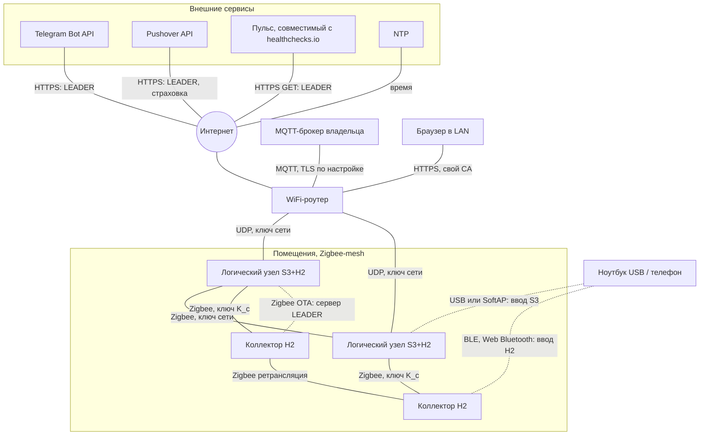

Коллекторы связаны только Zigbee и знают только свой ключ K_c. Логические узлы связаны Zigbee и UDP через роутер и одни выходят наружу. Внешние каналы обслуживает один узел: Telegram, Pushover и пульс — `LEADER` (AD-9, AD-10, AD-30), MQTT — MQTT-узел (AD-24). Адрес брокера задаёт владелец; брокер может быть в LAN, интернет для роли MQTT-узла не нужен (AD-9).

<a id="s1-2"></a>

### 1.2. Линии связи

| # | Стороны | Транспорт | Подпись / защита | Направление | Что идёт | Раздел |
| --- | --- | --- | --- | --- | --- | --- |
| Л1 | Коллектор → логические узлы | Zigbee (у коллектора только Zigbee), кадр ≤ 80 Б | HMAC ключом коллектора K_c (AD-5) | к каждому живому логическому узлу | события и сводные записи, снимки каналов, `output_state`, отказы и `fault` выходов, heartbeat коллектора, объявление `kid`, ACK адресных кадров, запрос `lw` | [3.1](#s3-1) |
| Л2 | Логический узел → коллектор | Zigbee, адресно | HMAC ключом K_c получателя (AD-5) | одному коллектору | ядро heartbeat, объявление `kid`, ответ `lw`, ACK событий, `output_cmd`, параметры каналов, `local_rules`, команды правил | [3.2](#s3-2) |
| Л3 | Логический ↔ логический | Zigbee и UDP по классу трафика (AD-12) | HMAC ключом сети `kid` (AD-5) | широковещательно и адресно | события, `ack`, `delivered`, `output_intent`, производные события, heartbeat, `W`, `lw`, обмен недостающими событиями, синхронизация конфига | [3.3](#s3-3) |
| Л4 | Любой узел → все | Zigbee (логические — и UDP) | ключ сети или K_c | широковещательно / адресно | heartbeat, объявление `kid` | [3.4](#s3-4) |
| Л5 | Ввод узла | USB; SoftAP (S3); BLE + Web Bluetooth (H2) | Security 2 с кодом с наклейки (PoP); пакет ключей зашифрован кодом с наклейки (AD-17, AD-23) | компьютер / телефон → узел | запись provisioning | [3.5](#s3-5) |
| Л6 | OTA | логический — UDP; коллектор — Zigbee OTA Upgrade cluster | образ с подписью, secure boot v2 (AD-17, AD-18) | `LEADER` → коллектор; веб → логический | образ прошивки | [3.6](#s3-6) |
| Л7 | `LEADER` ↔ Telegram Bot API | HTTPS (TLS только после NTP, AD-3) | токен бота — секрет узла (AD-23) | отправка и `getUpdates` | сообщения, правки, кнопки, аренда, команды | [4](#s4) |
| Л8 | `LEADER` (критичное — и `FOLLOWER`/`YIELDED`) → Pushover | HTTPS | ключ группы Pushover — секрет узла | отправка и опрос receipt | критичные тревоги, отмена копий | [5](#s5) |
| Л9 | Логические узлы ↔ MQTT-брокер | MQTT 3.1.1 / 5; команды — только MQTT 5; TLS — мягкий конфиг | логин и пароль — секрет каждого узла | публикует MQTT-узел; на `set` подписаны все узлы с логином | `state`, `health`, `events`, `result`; команды `set` | [6](#s6) |
| Л10 | `LEADER` → пульс | HTTPS GET | адрес — мягкий конфиг, маскируется | наружу | пинг раз в период | [7](#s7) |
| Л11 | Браузер ↔ логический узел | HTTPS, сертификат от собственного CA системы; только LAN | логин и пароль веба — секрет узла | запрос–ответ | настройка, команды выходов, ввод, OTA | [8](#s8) |
| Л12 | Логический узел → NTP | протокол и серверы не зафиксированы | — | наружу | время; без NTP источник времени — `LEADER` (AD-20) | [3.4](#s3-4) |

---

<a id="s2"></a>

## 2. Общий формат кадра между устройствами

Источник истины в коде — `components/proto`, обе прошивки собирают его; контракт байтов — `wire-format.md` (AD-5).

<a id="s2-1"></a>

### 2.1. Кадр

`[body, kid, m]` — CBOR-массив из 3 элементов (`wire-format.md`).

| Поле | Тип и граница | Макс. байт |
| --- | --- | --- |
| заголовок массива | 3 элемента | 1 |
| `body` | байтовая строка ≤ 255 Б (заголовок) | 2 + тело |
| `kid` | uint ≤ 23 | 1 |
| `m` | байтовая строка 8 Б: HMAC-SHA256 ключом `kid` (32 Б) над сырыми байтами `body`, усечённый до `GA_PROTO_MAC_BYTES` | 9 |
| **итого служебное** | | **13** |

- Подпись считается над байтами `body` как они пришли, без каноникализации. Пересылающий узел передаёт `body` байт в байт и никогда не перекодирует (AD-5).
- Предел одного Zigbee-кадра — `GA_ZB_FRAME_MAX_BYTES` = 80 Б. Предельный размер кадра по UDP — **не зафиксировано** (история 3.2).

<a id="s2-2"></a>

### 2.2. Конверт

`body = [hdr, t, n, b, q, lwd, ts, p]` — позиционный CBOR-массив (`wire-format.md`).

| # | Поле | Тип и граница | Макс. байт |
| --- | --- | --- | --- |
| — | заголовок массива | 8 элементов | 1 |
| 0 | `hdr` | uint: `v` (3 бита, старшие) · поток (2 бита: широковещательный надёжный / адресный надёжный / ненадёжный) · класс `c` (2 бита: `sensor` / `critical` / `bulk`) · `k` (1 бит, критично) | 2 |
| 1 | `t` | uint, тип; типы, идущие по Zigbee, — коды ≤ 23 | 1 |
| 2 | `n` | uint64, EUI-64 отправителя | 9 |
| 3 | `b` | uint32, номер загрузки | 5 |
| 4 | `q` | uint32, `seq` своего потока | 5 |
| 5 | `lwd` | uint32, `q − lw`; у ненадёжного потока 0 | 5 |
| 6 | `ts` | uint64, UTC мс; у команды выхода — стенка HLC команды | 9 |
| 7 | `p` | массив, нагрузка типа | см. разделы 3.1–3.3 |
| | **итого без `p`** | | **37** |

**Кадр = 13 + 37 + `p` ≤ `GA_ZB_FRAME_MAX_BYTES` (80) ⇔ `p` ≤ 30 Б** (`wire-format.md`).

- Конверт заморожен в пределах мажорной версии `v`: новых полей нет, изменение конверта — новая мажорная версия. Нагрузка может получить хвостовые поля, если её строка в `wire-format.md` остаётся ≤ 80 Б с тестом размера; поле из середины присутствует всегда (AD-5, AD-6).
- Четвёртое значение потока или класса в `hdr` — ошибка формата, кадр отвергается (`wire-format.md`).
- Класс `c` выбирает путь, его читает только `Mesh` (AD-12):

| Класс | Что входит | Путь |
| --- | --- | --- |
| `sensor` | данные датчиков | Zigbee |
| `critical` | тревоги, ACK, `delivered`, `ack`, heartbeat, `output_cmd`, `output_state`, `output_intent` | Zigbee и UDP одновременно, получатель отсеивает дубль; у коллектора — только Zigbee |
| `bulk` | синхронизация конфига и исходных событий, `local_rules`, OTA | UDP; по Zigbee — только при недоступности UDP и с ограничением `GA_BULK_ZB_RATE` (значение — история 3.2); всегда уступает `critical` |

<a id="s2-3"></a>

### 2.3. Подпись, ключи и `kid`

| Линия | Ключ | Основание |
| --- | --- | --- |
| логический ↔ логический | ключ сети этого `kid`, 32 Б (`GA_NET_KEY_BYTES`) | AD-5, AD-17 |
| коллектор → логический | K_c этого коллектора | AD-5 |
| логический → коллектор (только адресно) | K_c получателя | AD-5 |
| широковещательные кадры логических узлов | ключ сети; коллектор их не проверяет и не использует | AD-5 |

- **K_c** = HKDF-SHA256 (RFC 5869) без соли от ключа сети `kid`; info = ASCII «ga2-collector» ‖ EUI-64 коллектора (8 Б, big-endian) ‖ номер воплощения из `node/<eui>` (uint32, big-endian); ключ 32 Б (`wire-format.md`, AD-5). Логический узел выводит K_c сам по `n` кадра и роли узла в `node/<eui>`. После «забыть узел» и повторного ввода — новое воплощение и новый K_c (AD-23).
- **Что принимается с подписью K_c.** Только если `n` — этот коллектор и тип разрешён коллектору: события и снимки своих каналов (принадлежность `channel_id` — по описанию каналов), heartbeat и его части, объявление `kid`, `output_state` своих выходов, ACK адресных кадров, запрос `lw`. `ack`, `delivered`, `output_intent`, `output_cmd`, конфиг и прочие типы с такой подписью отвергаются (AD-5).
- **`kid`** — номер ключа 0…23 по кругу, не версия; одновременно действуют не больше двух. Сам ключ приходит только при вводе узла и между узлами не передаётся никогда (AD-5, `wire-format.md`). Порядок смены ключа — раздел [3.5](#s3-5).
- **Пересылка со старым `kid`.** По UDP тело со старым `kid` вкладывается в конверт, подписанный текущим ключом; по Zigbee исходный кадр пересылается как есть, пока идёт `GA_KID_TRANSITION` (вложение не помещается в кадр) (AD-5).
- **Переподпись.** Автор, повторяющий своё неподтверждённое событие, переподписывает тот же `body` текущим ключом (AD-5).

<a id="s2-4"></a>

### 2.4. Потоки `seq`, антиповтор и свежесть

ID узла — EUI-64; ID события — `(node, boot, seq)` = поля `n`, `b`, `q`. `boot` растёт и пишется в `app_main` до создания задач; `Delivery` не шлёт ни одного кадра до `boot_ready` (AD-7). Каждый поток начинается с 0 в каждой загрузке.

| Поток (в `hdr`) | Что несёт | Защита на приёме |
| --- | --- | --- |
| широковещательный надёжный | события, `ack`, `delivered`, `output_intent`, отказы и `fault` выходов; его номер — ID события | окно антиповтора |
| адресный надёжный, счётчик на пару `(src, dst)` | синхронизация конфига, параметры каналов коллектора, команды правил, `output_cmd`, `local_rules` | окно антиповтора |
| ненадёжный | heartbeat, снимки (в том числе `output_state`), ACK | свежесть по `(boot, seq)` с ключом объекта (узел, тип, объект — канал, выход, номер части); старый снимок не заменяет новый; `lwd` = 0 |

**Окно антиповтора** (AD-17): на поток — `GA_SEQ_WINDOW` = 512 номеров; база = max(непрерывный префикс принятых, `lw` из кадра), никогда не уменьшается. Кадр за окном не подтверждается — отправитель повторит. Непринятое никогда не считается дублем. Повтор принятого получает ACK заново и дальше не передаётся.

**`lw` (low-water).** Отправитель поднимает `lw` только за номерами, которые он больше никому не повторит и содержимое которых учтено: событие покинуло буфер по AD-8; некритичное вытеснено; фронт поглощён сводной записью; адресное сообщение подтверждено, истекло по TTL или заменено новой версией. Продвижение `lw` — не признак доставки и не основание удалять событие (AD-17).

**Приём через перезагрузки `accept(node, boot, seq)`** — только для кадров, полученных напрямую от источника (AD-17). Получатель хранит окна последних `GA_DEDUP_BOOTS` = 4 загрузок узла.

| Загрузка кадра | Решение |
| --- | --- |
| текущая | решает окно |
| новее текущей | новая загрузка, новое окно |
| известная прошлая | её окно; если окна нет — `seq` ≥ её `lw` из последнего heartbeat отправителя (коллектор получает `lw` логического узла только адресным ответом на свой запрос) |
| неизвестная, старше хранимых | только если загрузка не закрыта и `seq` ≥ её `lw` из сообщения `lw` текущей загрузки |
| неизвестная, данных о `lw` нет | без ACK и без засчёта в глухоту; получатель запрашивает список `lw` адресно |
| закрытая (номер < `min_open_boot` из ядра heartbeat или `lw` дошёл до конца) | не принимается |

Получатель хранит во FRAM максимальный известный `boot` каждого узла и отбрасывает снимки и сообщения `lw` с меньшим `boot` (AD-7).

<a id="s2-5"></a>

### 2.5. Порядок обработки входящего кадра

| Шаг | Действие | При ошибке | Основание |
| --- | --- | --- | --- |
| 1 | разбор внешнего массива `[body, kid, m]`; в `body` — только `n` (третий элемент конверта) ограниченным разбором фиксированной позиции | кадр отвергается | AD-5 |
| 2 | выбор ключа по `kid` и `n`: ключ сети или K_c (по роли узла в `node/<eui>` и воплощению) | неизвестный или удалённый после `T_end` `kid` — кадр отвергается; логический узел, не знающий текущего воплощения коллектора, даёт одно событие здоровья на эпизод, а не на кадр | AD-5, AD-23 |
| 3 | проверка HMAC над сырыми байтами `body` до декодирования | кадр отвергается, без ACK | AD-5, история 2.4 |
| 4 | декодирование конверта; `v` < `PROTO_MIN_VERSION` или четвёртое значение потока/класса | кадр отвергается | AD-6, `wire-format.md` |
| 5 | подпись K_c: `n` — этот коллектор, тип разрешён, `channel_id` принадлежит ему | кадр отвергается | AD-5 |
| 6 | надёжный поток — `accept()` и окно; ненадёжный — свежесть по `(boot, seq)` | без ACK (отправитель повторит) или снимок игнорируется | AD-7, AD-17 |
| 7 | `ts` чужого кадра дальше `now` + `GA_TS_FUTURE_MAX` (5 мин) | событие принимается с пометкой «время неверно» и событием здоровья; HLC узла дальше этого предела не продвигается; правила и эпизоды считают его по времени приёма | AD-5 |
| 8 | незнакомый тип | событие подтверждается, хранится и реплицируется как непрозрачный `body`; маршрут и критичность — из `c` и `k`; лишние хвостовые элементы нагрузки пропускаются | AD-6 |
| 9 | событие: запись в журнал FRAM через `Storage`, затем ACK | журнал полон необработанным — нет ACK, флаг «журнал полон» в ядре heartbeat | AD-4, AD-28 |

<a id="s2-6"></a>

### 2.6. Версии N и N−1

- Узел версии N понимает N−1; кадры с `v` ниже `PROTO_MIN_VERSION` отвергаются; алгоритм и длина подписи в пределах поддерживаемых версий не ослабевают (AD-6). Числовое значение `PROTO_MIN_VERSION` и первой версии — **не зафиксировано** в документах (`components/proto`, история 1.2).
- Поля не удаляются и не меняют смысл внутри мажорной версии; новые данные — новыми типами или хвостом нагрузки (AD-5, AD-6).
- Команда выхода не отправляется коллектору, в описании каналов которого нет этого выхода (AD-29).
- Экземпляр правила с незнакомым шаблоном не исполняется и помечается в вебе (AD-6).

<a id="s2-7"></a>

### 2.7. Идентификаторы, хеши и метка команды

- Хеши — первые 8 Б SHA-256 от канонического CBOR-массива (минимальная длина целых, байтовые строки как есть); тестовые векторы — `proto/test` (`wire-format.md`).

| Идентификатор | Вход хеша | Основание |
| --- | --- | --- |
| `cmd_id` команды правила | `[rule_id, n, b, q]` причины (у оконного правила — производного события) | AD-29 |
| `cmd_id` ручной команды веба и бота = `event_id` намерения | `[n, b, q]` намерения | AD-29 |
| `cmd_id` команды MQTT = `mqtt_key` | `[тема, id]`, `id` обязателен | AD-24 |

- `channel_id`, `rule_id` — uint16 = слот узла-создателя (4 бита) · счётчик (12 бит) (AD-7).
- Производное событие — `rule_id@window_start`, `window_start = floor(ts_источника / длина_окна) × длина_окна` (AD-7).
- **Метка команды выхода** — пара HLC (`wall_ms`, счётчик): `wall_ms` идёт в `ts` конверта, счётчик — в нагрузке. Порядок двух команд одного слота — по (`ts`, счётчик, `cmd_id`), «новее» — строго больше; переполнение счётчика: `ts` += 1 мс, счётчик = 0 (AD-29, `wire-format.md`).

| Источник команды | `wall_ms` | Счётчик |
| --- | --- | --- |
| правило логического узла | `ts` причины (у оконного — `window_start`), в том числе по опоздавшей причине | 0 |
| `release` по `ack` | max(`ts` подтверждения, `ts` включившей команды) + 1 мс | 0 |
| веб и бот | HLC принявшего узла, не меньше последней известной ему пары этого выхода | по HLC |
| MQTT и страховка ведомого | `ts` из JSON в мс | 0 |
| локальное правило | время последнего heartbeat + монотонное время; без heartbeat с загрузки — максимальная пара слотов из NVS, счётчик + 1, флаг «время неизвестно» | по HLC |
| повтор после перезагрузки коллектора | исходная пара без изменений | без изменений |

<a id="s2-8"></a>

### 2.8. Сводка типов сообщений

Числовые коды `t` назначаются в `proto` — **не зафиксировано** в документах (история 1.2 и истории, вводящие тип). Коды 0–23 зарезервированы за типами Zigbee; типы только для UDP могут иметь коды > 23 и большие нагрузки (`wire-format.md`).

| Тип | Линия | Поток | Класс | Раскладка `p` | Раздел |
| --- | --- | --- | --- | --- | --- |
| событие (фронт, пересечение порога) | Л1, Л3 | широковещательный надёжный | `critical` для тревог, иначе `sensor` | не зафиксировано (истории 2.3, 2.4, 7.1) | [3.1](#s3-1) |
| сводная запись слияния фронтов | Л1 | широковещательный надёжный | `critical` | не зафиксировано (история 2.4) | [3.1](#s3-1) |
| состояние канала (снимок) | Л1, Л3 | ненадёжный | `sensor` | 15 Б, кадр 65 Б | [3.1](#s3-1) |
| описание каналов | Л1, Л3 | не зафиксировано (история 7.1) | не зафиксировано | не зафиксировано | [3.1](#s3-1) |
| событие здоровья | Л1, Л3 | широковещательный надёжный | `critical` для критичного канала | не зафиксировано | [3.1](#s3-1) |
| ACK (транспортный) | все | ненадёжный | `critical` | не зафиксировано | [3.1](#s3-1) |
| heartbeat (ядро и части) | Л1–Л4 | ненадёжный | `critical` | не зафиксировано (история 3.1) | [3.4](#s3-4) |
| объявление `kid` | Л1–Л4 | ненадёжный (часть heartbeat) | `critical` | не зафиксировано (история 3.1) | [3.4](#s3-4) |
| запрос и ответ `lw` | Л1, Л2 | не зафиксировано | не зафиксировано | не зафиксировано (история 3.1) | [3.4](#s3-4) |
| `output_cmd` | Л2 | адресный надёжный | `critical` | 20 Б, кадр 70 Б | [3.2](#s3-2) |
| `output_state` | Л1 | ненадёжный (снимок) | `critical` | 27 Б, кадр 77 Б | [3.1](#s3-1) |
| отказ команды, `fault` выхода | Л1 | широковещательный надёжный (фронт) | не зафиксировано | не зафиксировано | [3.1](#s3-1) |
| `local_rules` (часть) | Л2 | адресный надёжный | `bulk` | 25 Б, кадр 75 Б | [3.2](#s3-2) |
| параметры каналов коллектора | Л2 | адресный надёжный | не зафиксировано | не зафиксировано | [3.2](#s3-2) |
| команда правила (опросить, burst-интервал) | Л2 | адресный надёжный | не зафиксировано | не зафиксировано (история 8.7) | [3.2](#s3-2) |
| `output_intent` | Л3 | широковещательный надёжный | `critical` | 20 Б, кадр 70 Б | [3.3](#s3-3) |
| `ack{event_id, by}` | Л3 | широковещательный надёжный | `critical` | не зафиксировано (история 3.7) | [3.3](#s3-3) |
| `delivered` (с `message_id`) | Л3 | широковещательный надёжный | `critical` | не зафиксировано (история 3.7) | [3.3](#s3-3) |
| производное событие, открытие эпизода | Л3 | широковещательный надёжный | не зафиксировано | не зафиксировано | [3.3](#s3-3) |
| сводка `(node, boot) → seq`, запрос недостающих | Л3 | не зафиксировано | `bulk` | не зафиксировано (история 3.5) | [3.3](#s3-3) |
| запись синхронизации конфига | Л3 | адресный надёжный | `bulk` | не зафиксировано (история 3.10) | [3.3](#s3-3) |
| водяной знак `W` | Л3 | ненадёжный (часть heartbeat) | не зафиксировано | не зафиксировано (история 3.1) | [3.4](#s3-4) |

---

<a id="s3"></a>

## 3. Устройство ↔ устройство

<a id="s3-1"></a>

### 3.1. Коллектор → логические узлы

Общее для линии Л1: Zigbee, подпись K_c коллектора, кадр ≤ 80 Б. Получателей коллектор берёт только из адресного heartbeat логических узлов, подписанного его K_c; живость — по `Membership` (AD-8, AD-19). Режим Zigbee-адресации событий коллектора (unicast каждому или Zigbee-широковещание) прямо **не зафиксирован**: AD-8 требует «отправляет каждому живому и повторяет до ACK», история 3.1 считает события в бюджете широковещания (решение — истории 1.7, 3.1).

#### 3.1.1. Событие датчика (фронт)

| Пункт | Содержание |
| --- | --- |
| Назначение | изменение состояния канала, пересечение порога, заданного каналу в мягком конфиге (AD-15) |
| Отправитель → получатель | `Delivery` коллектора → `Delivery` каждого живого логического узла |
| Поток, класс | широковещательный надёжный; `c` = `critical` для тревог, иначе `sensor`; `k` ставит источник по своей копии параметров (AD-8, AD-12, AD-14) |
| Когда | фронт после антидребезга и cooldown (`GA_ALARM_DEBOUNCE` 200 мс / `GA_ALARM_COOLDOWN` 2 мин; PIR — `GA_MOTION_DEBOUNCE` 400 мс / `GA_MOTION_COOLDOWN` 5 мин / `GA_PIR_WARMUP` 60 с) |
| Перед отправкой | запись в буфер NVS через `Storage`; критичный фронт — всегда, сверх бюджета `GA_COLLECTOR_NVS_BUDGET` (2000/сут); некритичный при исчерпанном бюджете — только RAM, с событием здоровья (AD-8) |
| Нагрузка | **не зафиксировано** (истории 2.3, 2.4, 7.1); `wire-format.md` даёт только строку «состояние канала» (ниже), явно ли фронт использует её — не сказано |
| Ответ | ACK от каждого логического узла — только после записи события в журнал FRAM (AD-4, AD-28) |
| Повторы | до ACK, каждому узлу отдельно, экспоненциальная пауза из `ga_config.h` (история 2.4); значения паузы — **не зафиксировано** |
| Выпуск из буфера | любое — после ACK хотя бы одного узла; некритичное — плюс ACK всех живых или `GA_ACK_ALL_TIMEOUT` (5 мин); критичное — ACK всех живых неглухих и не меньше двух, если неглухих ≥ 2 (AD-8) |
| Глухой узел | живой по heartbeat, но без ACK за `GA_ACK_ALL_TIMEOUT` и ≥ `GA_DEAF_MIN_RETRIES` (10) повторов — исключается из ожидаемых, одно критичное событие здоровья на эпизод; первый ACK снимает глухоту; неподтверждения узла с флагом «журнал полон» в глухоту не засчитываются (AD-8, AD-28) |
| Переполнение буфера | вытесняются снимки, затем старейшие некритичные; неподтверждённое критичное не вытесняется; сверх `GA_COLLECTOR_CRIT_PER_CHANNEL` (4) критичные фронты канала сливаются в сводную запись (первый, последний, счётчик) в резерве `GA_COLLECTOR_CRIT_RESERVE` (32) (AD-8) |
| Дедуп | у получателя — по `(node, boot, seq)` и окну; повтор принятого — ACK заново (AD-17) |
| Пока параметры каналов не подтверждены | коллектор хранит все свои фронты как критичные; логический узел может повысить `k` по своему конфигу («`k` не ниже X»), понизить — нет (AD-8, AD-14) |

#### 3.1.2. Сводная запись слияния фронтов

Создаётся в буфере коллектора при переполнении критичного (выше). Получает новый `seq`, несёт диапазон поглощённых номеров (включая прежний номер перевыпущенной сводной записи) и сама требует ACK. Пишется в NVS сверх бюджета не чаще `GA_COLLECTOR_CRIT_MERGE_PERSIST` (60 с); между записями счётчик и последний фронт — в RAM (AD-8, AD-17). Раскладка — **не зафиксировано** (история 2.4).

#### 3.1.3. Состояние канала (снимок)

| Пункт | Содержание |
| --- | --- |
| Поток, класс | ненадёжный; `sensor` |
| Когда | по изменению и периодически (AD-15); период — **не зафиксировано** |
| Хранение | в NVS не пишется никогда; в буфере — только последнее значение канала (AD-8) |
| Ответ | нет |
| Приём | применяется, только если новее по `(boot, seq)` того же объекта (AD-7) |

Нагрузка (`wire-format.md`):

| Поле `p` | Макс. байт |
| --- | --- |
| `channel_id` | 3 |
| вид (3 бита) · здоровье (3 бита) | 2 |
| значение int64 или float | 9 |
| заголовок массива | 1 |
| **итого `p` / кадр** | **15 / 65** |

#### 3.1.4. Описание каналов

Узел публикует описание каналов по смене версии (AD-15); выход описывается тем же самоописанием (AD-29). По нему проверяется принадлежность `channel_id` коллектору (AD-5) и решается, слать ли команду выходу (AD-29). Поток, класс и раскладка — **не зафиксировано** (история 7.1).

#### 3.1.5. `output_state`

| Пункт | Содержание |
| --- | --- |
| Назначение | подтверждённое состояние выхода: значение, уровень и метка действующего слота |
| Поток, класс | ненадёжный (снимок); `critical` (у коллектора — Zigbee) (AD-12, AD-29) |
| Когда | по смене действующего слота или уровня, не по такту паттерна зуммера; после отсечения по `max_on` — с причиной (AD-29) |
| Ответ | нет; порядок — по выпуску у владельца `(boot, seq)`, не по метке слота (`wire-format.md`) |

Нагрузка (`wire-format.md`):

| Поле `p` | Макс. байт |
| --- | --- |
| `channel_id` | 3 |
| 7 бит: `level` (2) · `value` (2) · подтверждение (2: нет входа / разомкнут / замкнут; у крана — нет концевиков / открыт / закрыт / между) · время неизвестно (1) | 2 |
| `cmd_id` | 9 |
| `wall_ms` слота | 9 |
| счётчик HLC | 3 |
| заголовок массива | 1 |
| **итого `p` / кадр** | **27 / 77** |

Худший случай всей таблицы: запас 3 Б, расширять `output_state` по Zigbee некуда — новые данные выхода идут новым типом (`wire-format.md`).

#### 3.1.6. Отказы команд и `fault` выхода

Фронтами (хранятся до ACK, широковещательный надёжный поток) идут только отказы и `fault`; отсечение по `max_on` — тоже фронтом, по нему логический узел помечает запись таблицы последних команд «отсечена» (AD-29). Отказ `stale` сообщается только источнику ручной команды (ответ бота или веба, `result` MQTT); отклонения команд правил пишутся в журнал без уведомления; `expired` — не отказ пользователю (AD-29). Раскладка — **не зафиксировано** (эпик 10).

#### 3.1.7. Событие здоровья

Пропавший узел, канал в `stale` / `open` / `short`, глухой узел, разный `GA_CONFIG_VERSION`, неисправность подтверждения выхода и т. п. — событие шаблона «здоровье», для критичного канала критичное (AD-19, AD-25). Идёт как обычное событие (3.1.1). Раскладка — **не зафиксировано**.

#### 3.1.8. ACK адресных кадров и запрос `lw`

- Коллектор подтверждает адресные кадры логических узлов (`output_cmd`, параметры каналов, `local_rules`, команды правил). ACK — ненадёжный поток, класс `critical`. Слот `protect` пишется в NVS **до** ACK (AD-29). Коллектор, не знающий времени, команды логических узлов не исполняет и не подтверждает до первого heartbeat логического узла — отправитель повторит; исключение — локальные правила (AD-29). Когда коллектор подтверждает части `local_rules` (до или после записи полной версии) — **не зафиксировано** (история 10.5).
- Запрос `lw`: коллектор запрашивает у логического узла `lw` его прошлых загрузок; ответ — только адресный (AD-17, AD-19). Раскладка запроса и ответа — **не зафиксировано** (история 3.1).

#### 3.1.9. Поток: событие датчика до доставки наружу

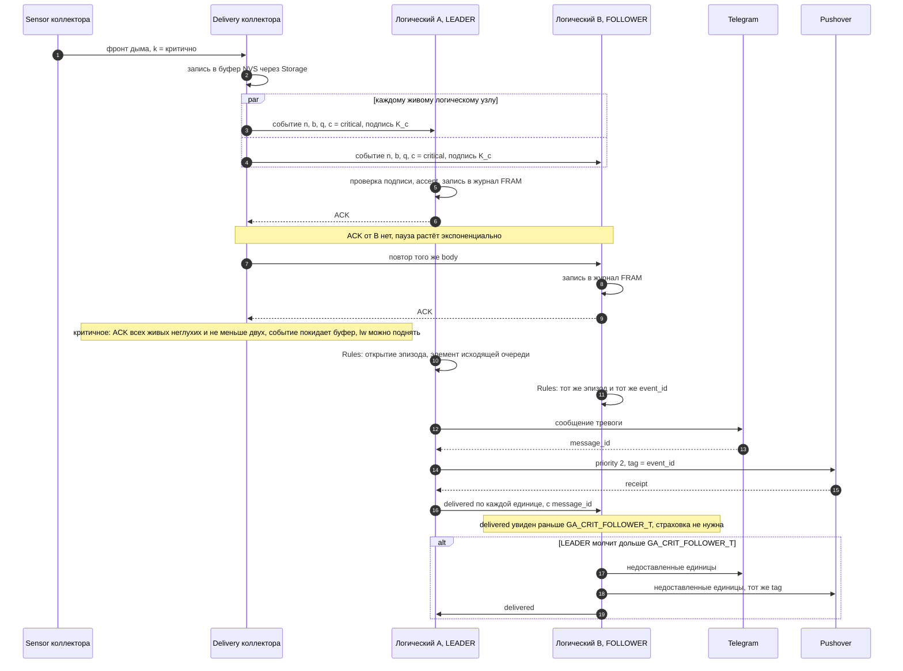

<a id="s3-2"></a>

### 3.2. Логический узел → коллектор

Общее для линии Л2: Zigbee, только адресно, подпись K_c получателя (AD-5). Коллектор узнаёт список логических узлов и время только из адресного heartbeat (AD-19).

#### 3.2.1. Ядро heartbeat, объявление `kid`, ответ `lw`

Описаны в разделе [3.4](#s3-4). Коллектору идут адресно: ядро — каждый период heartbeat по Zigbee; объявление `kid` — только при смене и по запросу коллектора; `lw` прошлых загрузок — только ответом на запрос (AD-12, AD-19).

#### 3.2.2. ACK событий коллектора

ACK — после записи события в журнал FRAM (AD-4). Журнал полон необработанным — ACK нет, флаг «журнал полон» в ядре heartbeat (AD-28). Кадр неизвестной прошлой загрузки без данных о `lw` — без ACK, запрос `lw` (AD-17).

#### 3.2.3. `output_cmd`

| Пункт | Содержание |
| --- | --- |
| Назначение | команда выходу: занять или очистить слот уровня `protect` / `manual` / `auto` |
| Отправитель → получатель | `Rules` **каждого** логического узла, без лидера → коллектор выхода (AD-29) |
| Поток, класс | адресный надёжный; `critical` (к коллектору — только Zigbee); целиком в одном кадре |
| Когда | правило: на открытие эпизода (у правил тревоги), на событие, `release` по норме или `ack`; ручная команда: по `output_intent` (раздел 3.3.2); после нового `boot` коллектора или выхода из `fault` — повтор последней команды каждого слота (AD-29) |
| Перед отправкой | запись в таблицу последних команд выходов во FRAM (регион `Rules`, ≤ `GA_OUTPUTS_MAX` × 3 записей) по тракту тревоги `Storage` (AD-29) |
| Ответ | ACK; для `protect` — после записи слота в NVS (резерв `GA_OUTPUT_NVS_RESERVE` = 8); итог — `output_state` или фронт отказа |
| Повторы | до ACK; TTL = срок команды (стенка метки + `dur_s`), без `dur_s` — без TTL; в буфере заменяется только командой того же выхода и уровня с большей меткой (AD-29) |
| Дедуп | по паре (`cmd_id`, `level`): повтор подтверждается и не применяется заново; тот же `cmd_id` выше уровнем — повышение, нижний слот очищается с сохранением метки (AD-29) |
| Ошибки на приёме | не новее слота — `stale`; срок истёк — `expired`; `pulse` без `dur_s` — отклонение (кодировщик отказывает `PROTO_ERR_FORMAT`); кран: `pulse` недопустим, `off` не новее последнего `on` уровня `protect` или при занятом `protect` — `stale`; коллектор без времени — нет ACK до первого heartbeat (AD-29, `wire-format.md`) |

Нагрузка (`wire-format.md`):

| Поле `p` | Граница | Макс. байт |
| --- | --- | --- |
| `cmd_id` | bstr 8 | 9 |
| `channel_id` | ≤ 65535 | 3 |
| `level` (2 бита) · `value` (2 бита: `on` / `off` / `release` / `pulse`) | — | 1 |
| счётчик HLC | ≤ 65535 | 3 |
| `dur_s` | ≤ 43200 (`GA_OUTPUT_MAX_ON_MAX`), 0 = нет; у `pulse` 0 < `dur_s` ≤ `GA_BUZZER_MAX` | 3 |
| заголовок массива | — | 1 |
| **итого `p` / кадр** | | **20 / 70** |

`wall_ms` метки — поле `ts` конверта (раздел [2.7](#s2-7)).

**Арбитраж на узле выхода** (AD-29). Слоты `protect` > `manual` > `auto`; команда, включая `release`, занимает слот, только если новее его метки; очищенный, истёкший или отсечённый слот хранит метку последней команды. Действует старший слот со значением, без них выход выключен. `protect` — в NVS до ACK; `manual` и `auto` — в RAM. `max_on` (по умолчанию `GA_OUTPUT_MAX_ON_DEFAULT` 1 ч, ≤ `GA_OUTPUT_MAX_ON_MAX` 12 ч) и `GA_BUZZER_MAX` (5 мин) считаются от перехода в `on` по монотонным часам и командами не перезапускаются. Подтверждение, не совпавшее с командой за `GA_OUTPUT_FEEDBACK_TIMEOUT` (500 мс; у крана — `valve_travel` + 500 мс), — `health = fault`.

**Потеря связи.** После `GA_OUTPUT_LINK_LOST_HB` (9 периодов heartbeat логического узла по Zigbee, 90 с при базовом периоде) без heartbeat — безопасное состояние `off | hold` для слотов `manual` и `auto`; `protect` держится; кран — только `hold`, без движения (AD-29).

**Перезагрузка коллектора.** Логический узел, увидевший новый `b` в heartbeat коллектора, шлёт последнюю команду каждого слота каждого выхода, включая `release` и `off`, с исходной меткой из таблицы во FRAM; истёкшая отклоняется как `expired`, запись «отсечена» держит слот очищенным. `GA_OUTPUT_BOOT_LOOP` (3) перезагрузок подряд во включённом состоянии (без `GA_OUTPUT_BOOT_STABLE` = 10 мин стабильной работы) — все слоты всех выходов в `off` с `fault`; через `GA_OUTPUT_BOOT_STABLE` в `fault` коллектор сообщает это в heartbeat, и логические узлы повторяют команды, как при новом `boot` (AD-29).

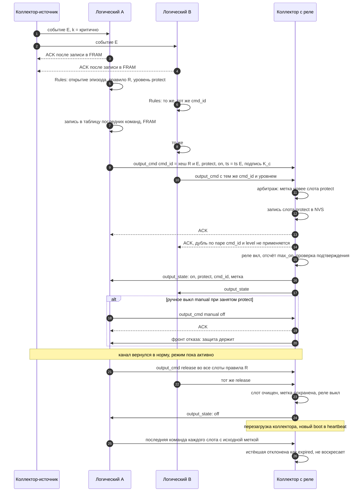

#### 3.2.4. Параметры каналов коллектора

Адресное надёжное сообщение с версией от `Config`; коллектор хранит копию через `Storage` и сообщает версию в ядре heartbeat (AD-14, история 3.10). Пока версия не подтверждена, коллектор хранит все фронты как критичные (AD-8). Класс и раскладка — **не зафиксировано** (истории 3.10, 7.1).

#### 3.2.5. `local_rules`

| Пункт | Содержание |
| --- | --- |
| Назначение | таблица локальных правил коллектора «событие своего канала → свой выход», без окна и `when` (AD-16) |
| Поток, класс | адресный надёжный; `bulk` (AD-12); у коллектора UDP нет, поэтому путь — Zigbee с ограничением `bulk` (следствие AD-12) |
| Объём | ≤ `GA_LOCAL_RULES_MAX` = 16 правил; одна часть — одно правило (4 бита на номер части) |
| Приём | части копятся отдельно от действующей таблицы; полная версия проверяется, пишется через `Storage` в неактивную копию A/B и переключается одной записью; неполная версия отбрасывается при приходе более новой или перезагрузке (AD-16) |
| Подтверждение | версия действующей таблицы — в ядре heartbeat коллектора; расхождение видно в вебе (AD-16, AD-19) |
| Ошибки | правило, нарушающее запреты крана, отвергает `Config` при сохранении и узел выхода при приёме (AD-29) |

Нагрузка части (`wire-format.md`):

| Поле `p` | Макс. байт |
| --- | --- |
| `version` uint32 | 5 |
| часть (4 бита) · (частей − 1) (4 бита) | 2 |
| правило или `null` для пустой таблицы | 17 |
| заголовок массива | 1 |
| **итого `p` / кадр** | **25 / 75** |

Правило внутри части:

| Поле | Макс. байт |
| --- | --- |
| `rule_id` | 3 |
| канал-вход | 3 |
| условие ≤ 255: вид фронта или номер порога канала, заданного источнику (AD-15); числового значения нет | 2 |
| канал-выход | 3 |
| `level` · `value` | 1 |
| режим ≤ 23 | 1 |
| `dur_s` | 3 |
| заголовок массива | 1 |
| **итого** | **17** |

Команда локального правила несёт тот же `cmd_id`, что у логических узлов, и тот же `ts`, если коллектор знает время; применяется один раз по `cmd_id` (AD-16).

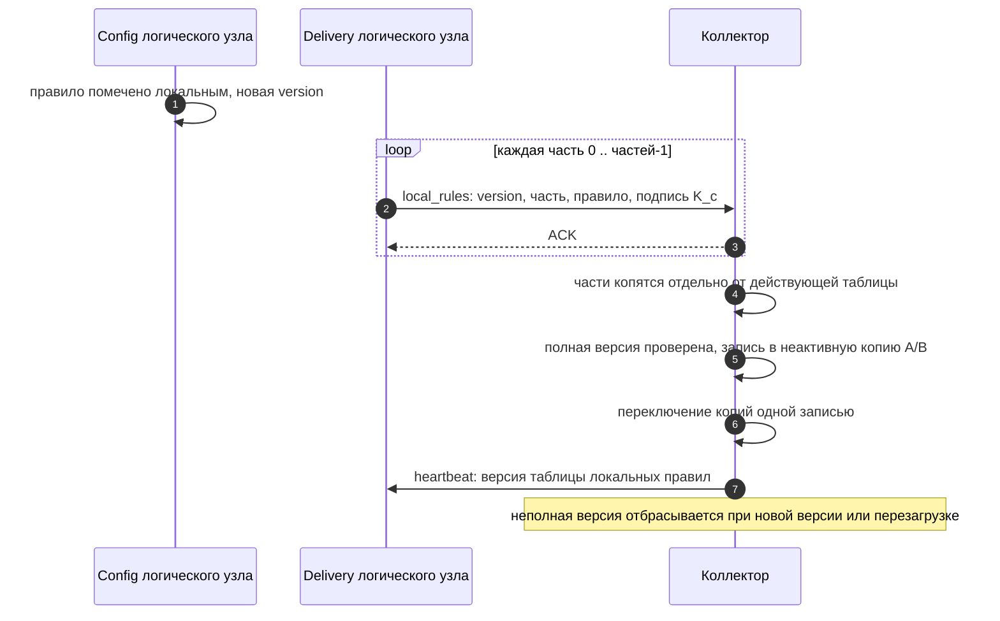

#### 3.2.6. Команды правил (опросить, burst-интервал)

Адресные надёжные сообщения через `Delivery`; у получателя доходят до `Sensor` событием по подписке; несут ID и TTL и откатываются сами (AD-16). Класс и раскладка — **не зафиксировано** (история 8.7).

<a id="s3-3"></a>

### 3.3. Логический узел ↔ логический узел

Общее для линии Л3: подпись ключом сети; путь по классу (AD-12): `critical` — Zigbee и UDP одновременно, получатель отсеивает дубль; `bulk` — UDP, по Zigbee только при недоступности UDP; `sensor` — Zigbee. При выключенном роутере связь идёт по Zigbee (история 3.2). UDP: порт, unicast или широковещание, обнаружение пиров — **не зафиксировано** (история 3.2).

#### 3.3.1. Исходные события логического узла и пересылка

События датчиков самого логического узла проходят через его `Delivery` (AD-2) и идут пирам тем же широковещательным надёжным потоком с ACK после записи в журнал. Правила выпуска и повторов те же, что у коллектора (AD-8, AD-17).

#### 3.3.2. `output_intent`

| Пункт | Содержание |
| --- | --- |
| Назначение | реплицируемое событие ручной команды выхода (веб, бот, MQTT): страховка ручной команды — обычная репликация событий (AD-29) |
| Поток, класс | широковещательный надёжный; `critical` |
| Создаёт | принявший узел: уровень `manual`; `ts` — HLC не меньше последнего известного `output_intent` / `output_state` этого выхода, у MQTT — из JSON `ts`; `cmd_id` = `event_id` намерения, у MQTT — хеш `[тема, id]` |
| Перед отправкой | запись в FRAM в резерв журнала `GA_FRAM_INBOX_OWN_RESERVE` (4 КБ); при исчерпанном резерве новое ручное намерение отклоняется с причиной (AD-28) |
| Дальше | `Rules` принявшего узла берёт намерение сразу после записи и шлёт `output_cmd`; остальные логические узлы — по приходу события (AD-29) |
| Ответ, повторы, дедуп | как у события: ACK после записи в журнал, повтор до ACK, дедуп по `event_id` |

Нагрузка (`wire-format.md`):

| Поле `p` | Макс. байт |
| --- | --- |
| `channel_id` | 3 |
| `level` · `value` | 1 |
| `dur_s` | 3 |
| счётчик HLC | 3 |
| `mqtt_key` bstr 8 или `null` (веб, бот) | 9 |
| заголовок массива | 1 |
| **итого `p` / кадр** | **20 / 70** |

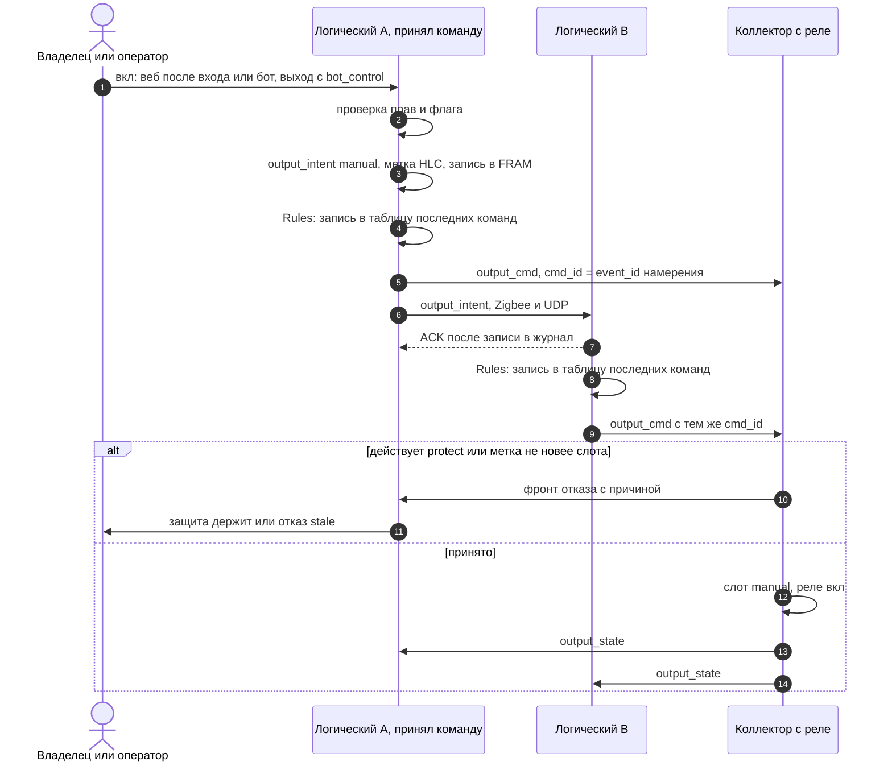

#### 3.3.3. `ack{event_id, by}` и `delivered`

| Сообщение | Назначение | Кто публикует | Основание |
| --- | --- | --- | --- |
| `ack{event_id, by}` | подтверждение тревоги человеком в любом канале; гасит повторы, напоминания и Pushover во всех каналах | узел, получивший «Принято» в Telegram или подтверждение по receipt Pushover | AD-21 |
| `delivered` | отметка доставки единицы `(event_id, recipient, channel)` с `message_id` | узел, который отправил эту единицу | AD-21 |

Оба — широковещательный надёжный поток, класс `critical`, запись в резерв журнала (AD-28). Коллектор такие кадры с подписью K_c не принимает (AD-5). Раскладка — **не зафиксировано** (история 3.7).

#### 3.3.4. Производные события и эпизоды

Производное событие правила и открытие эпизода публикуются через `Delivery` (AD-21); ID — `rule_id@window_start`, одинаковый на всех узлах; `Notify` отсеивает дубли по `event_id` в пределах `GA_RULE_WINDOW_MAX` + `GA_NOTIFY_IDEMP_MARGIN` (1 ч + 15 мин). Из пересекающихся открытий одного канала все узлы оставляют открытие с минимальным `ts` (AD-21). Пометка «`k` не ниже X», реплицируемая с событием, — формат **не зафиксирован** (истории 3.3, 3.10).

#### 3.3.5. Обмен недостающими событиями (anti-entropy)

| Пункт | Содержание |
| --- | --- |
| Назначение | довести каждое исходное событие до каждого живого логического узла, включая вернувшийся и глухой (AD-8) |
| Сообщения | сводка «`(node, boot)` → принятые `seq`» в пределах своего журнала, а не `lw`; запрос недостающих; ответ — сами события |
| Класс | `bulk` (AD-12) |
| Период, предел | `GA_SYNC_PERIOD`, `GA_SYNC_MAX_EVENTS` — **не зафиксировано** (история 3.5) |
| Формат | сводки, запроса и ответа — **не зафиксировано** (история 3.5) |
| Как пересылается событие | по UDP — `body` источника вкладывается в конверт пира, подписанный текущим ключом; по Zigbee — исходный кадр как есть (AD-5) |
| Приём | по подписи пира, вложившего событие (по Zigbee — по подписи источника), и дедупу по `event_id` журнала; подпись источника хранится как есть и повторно не проверяется; закрытость загрузки и `lw` не действуют; событие с `ts` старше начала журнала записывается без эффектов (AD-5, AD-17) |

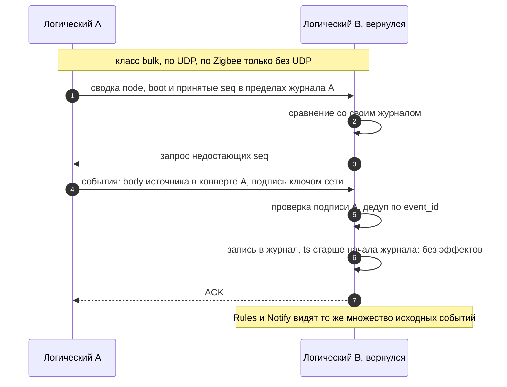

#### 3.3.6. Синхронизация мягкого конфига

| Пункт | Содержание |
| --- | --- |
| Назначение | реплицировать уровень S: имена, зоны, правила, режимы, подписчики, `leader_priority`, `leader_override`, параметры выходов, настройки MQTT, адрес пульса (AD-14, AD-30) |
| Писатель | только `Config`; версия на ключ; слияние LWW по HLC `(wall_ms, counter, EUI-64)`; удаление — надгробие (AD-14) |
| Поток, класс | адресный надёжный `(src, dst)`; `bulk`; медленный пир не останавливает приём у третьего узла (история 3.5) |
| Порядок | записи в порядке HLC; узел объявляет водяной знак `W` («есть все записи с HLC ≤ `W`») отдельным сообщением heartbeat по UDP (AD-14, AD-19) |
| Срок | правка на A видна на B за ≤ 1 мин (CAP-3) |
| Надгробия | удаляются старше `GA_TOMBSTONE_TTL` (30 сут) при `W` всех живых ≥ их HLC; надгробия `node/<eui>` — никогда (AD-14, AD-23) |
| Вернувшийся узел | отсутствовавший дольше `GA_TOMBSTONE_TTL` берёт конфиг у соседа с наибольшим `W`, свои расхождения показывает как конфликты (AD-14) |
| Формат записи | **не зафиксировано** (история 3.10) |

Секреты (токен Telegram, ключ Pushover, логин MQTT, логин и пароль веба) этим путём не идут никогда (AD-23).

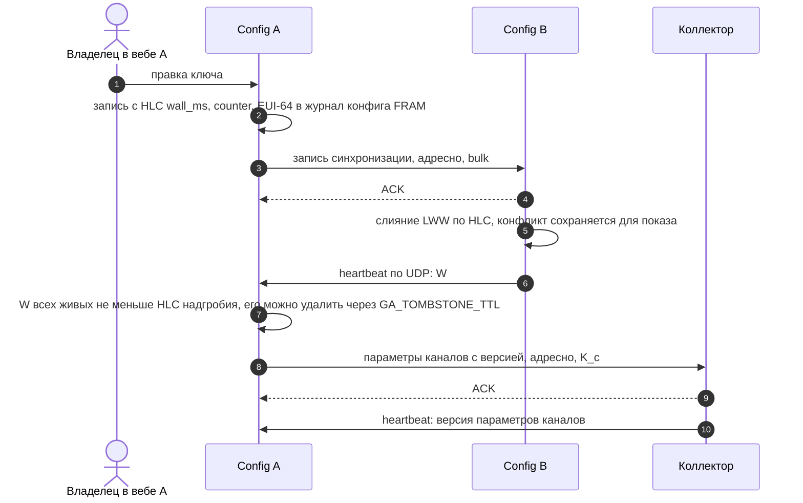

#### 3.3.7. Состояние `Notify` и исходящая очередь

- `offset` реплицируется как максимум, множество выполненных `update_id` — объединением с обрезкой до `GA_TG_EXECUTED_IDS` (64); оба — **до** исполнения команды; исполнение — после подтверждения `offset` хотя бы одним живым пиром, без пиров — после записи в FRAM (AD-10). Receipts Pushover реплицируются (история 4.4).
- Исходящая очередь хранится на каждом узле как набор единиц доставки; `delivered` и `ack` реплицируются событиями (AD-21, история 3.7).
- Тип сообщения для `offset`, множества `update_id`, receipts и отдельного элемента очереди — **не зафиксировано** (истории 3.7, 4.2, 4.4).

<a id="s3-4"></a>

### 3.4. Любой узел → все: heartbeat и объявление `kid`

Heartbeat — набор сообщений ненадёжного потока, каждое в один Zigbee-кадр, класс `critical` (AD-19). Время отправителя — `ts` конверта ядра.

| Сообщение | Поля | Кто | Путь у логического узла |
| --- | --- | --- | --- |
| ядро | роль, статус, `min_open_boot`, `GA_CONFIG_VERSION`; у логического — uplink, `uplink_since`, `leader_priority`, `mqtt_up`, период heartbeat по Zigbee, флаг «журнал полон»; у коллектора — версия параметров каналов и версия таблицы локальных правил | все | Zigbee: широковещательно логическим узлам (ключ сети), адресно каждому коллектору (K_c); и UDP |
| `W` | водяной знак конфига | логический | UDP; по Zigbee только без UDP и с ограничением `bulk` |
| `lw` по частям | `lw` незакрытых загрузок | все | UDP; коллектору — только адресным ответом на его запрос |
| здоровье | здоровье каналов; флаги наличия внешних секретов (без самих секретов) | все (флаги — логический) | UDP |
| объявление `kid` | действующие `kid` узла | все | логическим — широковещательно при смене и раз в `GA_KID_ANNOUNCE` (10 мин); коллектору — адресно при смене и по запросу |

Раскладка каждого сообщения и тест размера — **не зафиксировано** (история 3.1, строки в `wire-format.md`). Адресация heartbeat коллектора и периодичность объявления `kid` коллектором — **не зафиксировано** (история 3.1).

**Период.** Базовый: `GA_HB_LOGIC` = 10 с, `GA_HB_COLLECTOR` = 30 с. По Zigbee период растёт с числом узлов (записи `node/<eui>`):
`max(GA_HB_*, N_узлов / (GA_ZB_BCAST_RATE × GA_ZB_BCAST_HB_SHARE), N_логических × N_коллекторов / (GA_ZB_UCAST_RATE × GA_ZB_BCAST_HB_SHARE))`,
где `GA_ZB_BCAST_RATE` = 1/с, `GA_ZB_BCAST_HB_SHARE` = 50 %, `GA_ZB_UCAST_RATE` = 10/с (уточняются в истории 1.7). Логический узел объявляет период в ядре, коллектор берёт его оттуда. На стенде 2 + 2 — базовые периоды; при 16 + 32 — около 102 с и `stale` около 5 мин (AD-12).

**Что делают по heartbeat.**

| Получатель | Действие | Основание |
| --- | --- | --- |
| все | `GA_STALE_MISSED_HB` = 3 пропущенных периода — узел `stale`, событие «узел пропал» (критичное, если на узле есть критичные каналы) | AD-19, история 3.1 |
| логический | вычисляет `LEADER` и MQTT-узел (раздел ниже) | AD-9 |
| логический | новый `b` коллектора — повтор последних команд выходов | AD-29 |
| логический | разный `GA_CONFIG_VERSION` — событие здоровья | AD-25 |
| логический | флаг «журнал полон» — неподтверждения не засчитываются в глухоту | AD-28 |
| коллектор | список получателей событий и время — только из адресного heartbeat с его K_c | AD-19 |
| коллектор | `GA_OUTPUT_LINK_LOST_HB` = 9 периодов без heartbeat логических узлов — безопасное состояние `manual`/`auto` | AD-29 |

**Выбор лидера и MQTT-узла** — без обмена голосами, каждый логический узел сам по данным ядер (AD-9):

| Роль | Кандидаты | Порядок | Гистерезис |
| --- | --- | --- | --- |
| `LEADER` | логические узлы со здоровым uplink | min `leader_priority`, затем min EUI-64; лучший по приоритету возвращает лидерство только при `uplink_since` ≥ `GA_LEADER_RETURN` (15 мин); `leader_override{node, until}` действует сразу | `GA_UPLINK_LOST` 60 с / `GA_UPLINK_RESTORED` 120 с |
| MQTT-узел | логические узлы с `mqtt_up` | min `leader_priority`, затем min EUI-64; интернет не нужен | `GA_MQTT_UP_LOST` 30 с / `GA_MQTT_UP_RESTORED` 60 с |

Статусы: `LEADER` / `FOLLOWER` / `YIELDED` / `ISOLATED` (нет пиров и uplink — только копит). Узел без пиров, но с uplink — `LEADER`, не раньше `GA_JOIN_GRACE` (30 с) после старта; до этого или до первого heartbeat пира — `FOLLOWER` (AD-9). Ранг — позиция среди живых логических узлов в порядке выбора лидера, с 0 (AD-10).

**Время.** Логические узлы — NTP; без NTP источник времени — `LEADER` (AD-20); коллектор — из `ts` ядра адресного heartbeat (AD-19). Как именно ведомый логический узел берёт время у `LEADER` без NTP — **не зафиксировано**.

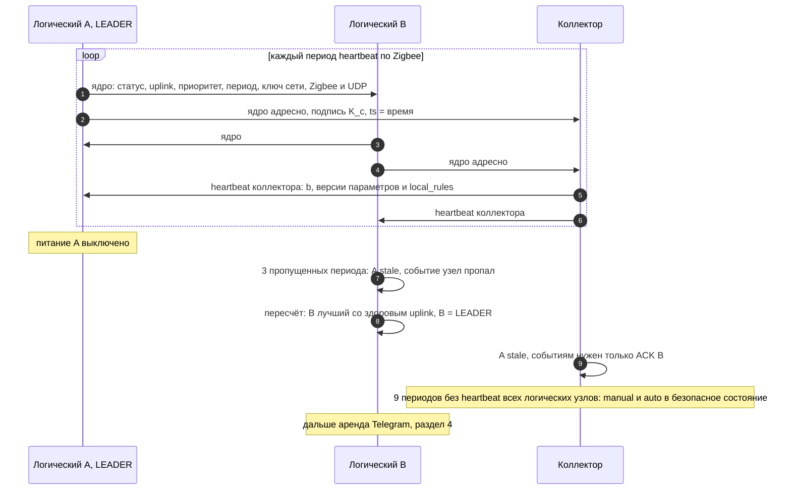

<a id="s3-5"></a>

### 3.5. Ввод узла и смена ключа сети

**Ввод** (AD-17, AD-23, `external-channels.md`). Окно ввода ограничено (`GA_PROVISION_WINDOW` = 5 мин), открыто после включения или по кнопке и только пока Zigbee-стек не запущен; после ввода выключается. Все способы пишут одну запись provisioning в один namespace. Размер сети ограничен `GA_LOGIC_NODES_MAX` (16) / `GA_COLLECTORS_MAX` (32) / `GA_OUTPUTS_MAX` (64); ввод сверх предела отказывает с объяснением в вебе.

| Передаётся | Логический (S3) | Коллектор (H2) |
| --- | --- | --- |
| роль, ключ Zigbee-сети | да | да |
| ключ HMAC сети с `kid` | да | — |
| свой K_c на каждый `kid` | — | да |
| WiFi, токен Telegram, `OWNER_CHAT_ID`, ключ Pushover, логин и пароль веба | да | — |
| логин и пароль MQTT | необязательно | — |
| имя и зона | необязательно | необязательно |

| Способ | Узел | Протокол |
| --- | --- | --- |
| USB | любой | раздел секретов (CSV), через прошивку, не через загрузчик |
| своя WiFi-точка (SoftAP), страница в любом браузере | логический | `network_provisioning` 1.2.5; «Создать новую сеть» (генерирует ключи сети и CA) или «Присоединиться» с пакетом ключей из веба работающего узла; Security 2 с кодом с наклейки (история 6.4) |
| BLE, Web Bluetooth из веба работающей системы («Добавить коллектор») | коллектор | `protocomm` со своим endpoint, Security 2 с кодом подтверждения (PoP) с наклейки (история 6.4) |

Пакет ключей нового узла шифруется кодом с его наклейки, одноразовый, действует `GA_KEYPACK_TTL` (30 мин); пакет коллектора несёт только его K_c (AD-23). Номер воплощения при повторном вводе после «забыть узел» — max(известный, надгробие) + 1 (AD-23).

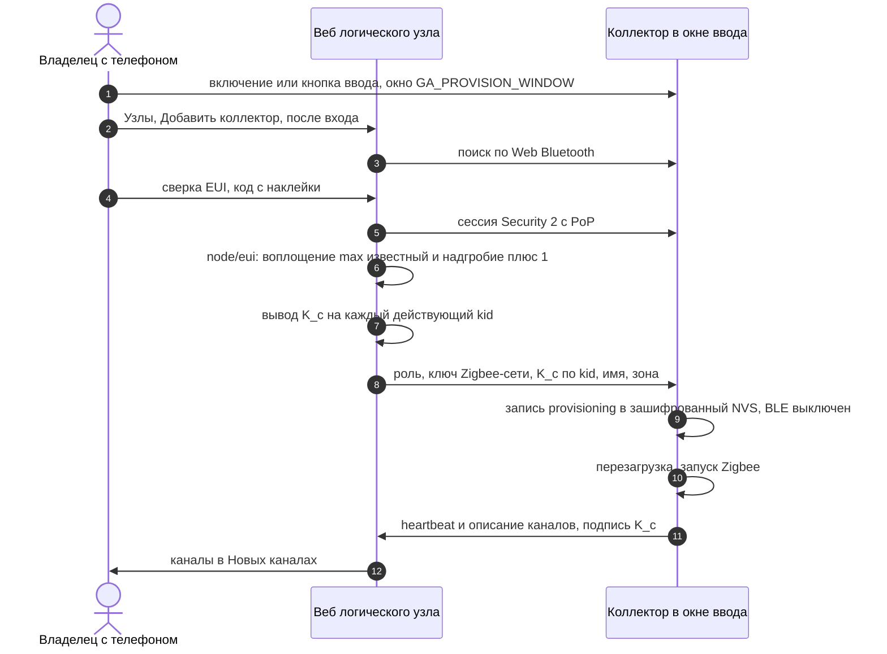

**Смена ключа сети** (AD-5, AD-23). Ключ меняется только повторным вводом каждого узла; по сети не передаётся никогда. Ключ Zigbee-сети не меняется (его смена — повторный ввод всех узлов с перерывом, вне MVP). Повторный ввод сохраняет воплощение, `boot`, буфер событий, слоты `protect`, счётчик зацикливания и журнал FRAM; после ввода автор переподписывает свой буфер текущим ключом.

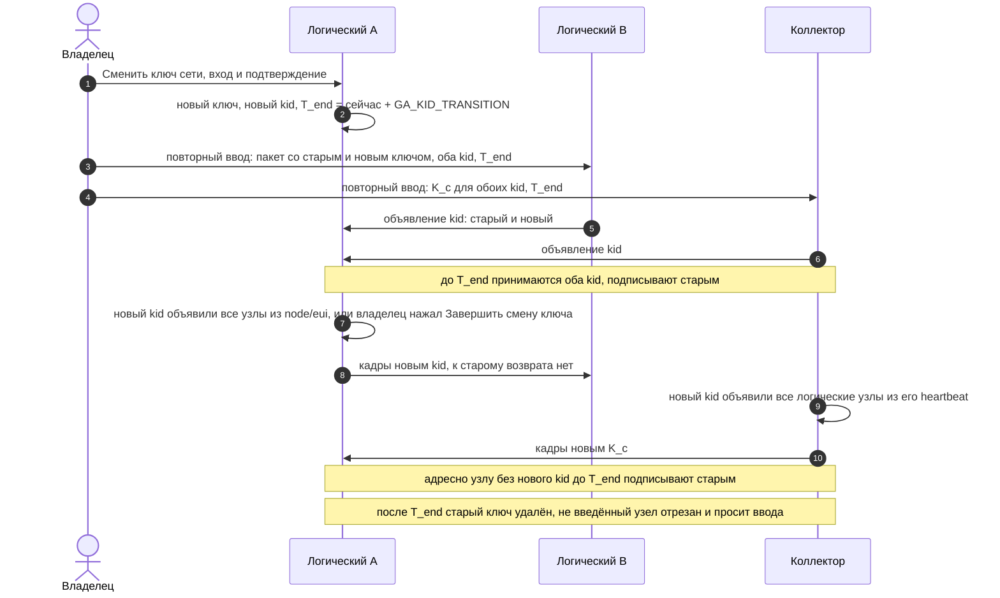

<a id="s3-6"></a>

### 3.6. OTA

| Пункт | Логический узел | Коллектор |
| --- | --- | --- |
| Путь | UDP, образ загружают через веб (AD-18); вместе с RCP-прошивкой своего H2 | Zigbee OTA Upgrade cluster, сервер — `LEADER`; класс `bulk`, ограничен по скорости и уступает `critical` (AD-12, AD-18) |
| Проверка | образ принимается только с валидной подписью; неподписанный — «Образ отклонён: подпись не подтверждена.» (AD-17, UX-DR47) | то же |
| Подтверждение | новая прошивка подтверждает себя только после входа в сеть, иначе откат (AD-18) | то же |
| Очередь | не больше одного узла одновременно (AD-18) | по одному; при смене лидера обновление продолжается или начинается заново (история 6.3) |
| Открыто | механизм сетевой блокировки «один узел за раз» и время проверки до отката — **не зафиксировано** (история 6.2) | работает ли OTA-сервер на роутере в distributed-сети — Q4 (история 1.6); запасной путь — своя передача образа через L2 (`bulk`); способ выбирается в истории 1.7 |

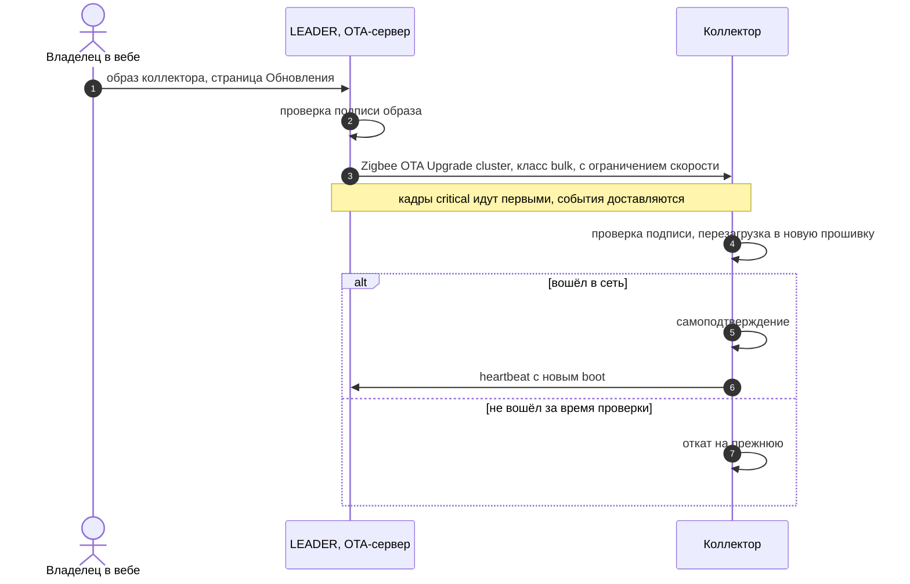

---

<a id="s4"></a>

## 4. Устройство ↔ Telegram

**Кто.** Отправляет и делает `getUpdates` только `LEADER`. `FOLLOWER` и `YIELDED` отправляют только критичное — страховкой по AD-11; в `YIELDED` нет `getUpdates` и некритичной отправки (AD-10). TLS — только после синхронизации времени; блокирующий TLS — только в задаче `Notify` (AD-3).

**Методы Bot API, названные в источниках.**

| Метод | Кто и зачем | Основание |
| --- | --- | --- |
| `getUpdates` (long polling) | `LEADER`: команды и нажатия кнопок; `offset` | AD-10, история 3.9 |
| `getChat` → `pinned_message` | узел, получивший 409: чтение аренды | AD-10 |
| `editMessage` с `parse_mode=HTML` | правка меню на месте; правка сообщения тревоги у всех получателей после «Принято» (`tg_msg_id` хранится по каждой единице доставки); строка «повторных срабатываний: N»; продление аренды «без звука и без нового закрепа» | UX-DR3, UX-DR17, AD-21, `EXPERIENCE.md` |
| `answerCallbackQuery` | на каждое нажатие кнопки | UX-DR3 |
| отправка нового сообщения, закрепление аренды | методы в источниках не названы — **не зафиксировано** (истории 2.5, 3.9) | — |

Параметры long polling (`timeout`, `allowed_updates`, `limit`) — **не зафиксировано** (истории 2.5, 3.9).

**Аренда** (AD-10, история 3.9). Закреплённое сообщение в чате владельца `lease{node, priority, until}`:

```text
📌 Связь держит «гараж» · до 03:27. Служебное, не откреплять.
<code>lease:1:<eui64>:<priority>:<until_epoch></code>
```

- `LEADER` продлевает аренду каждые `GA_LEASE_RENEW` (5 мин), срок — `GA_LEASE_TTL` (15 мин); продление правит то же сообщение без звука и без нового закрепа (`EXPERIENCE.md`).
- Аренда с незнакомой версией формата считается просроченной.
- Некритичное `LEADER` отправляет, только пока до конца аренды ≥ `GA_LEASE_RENEW`; критичное — всегда (AD-10).
- 409 на `getUpdates` означает только «есть второй опрашивающий»: чтение аренды; свежая чужая — `YIELDED` до её `until`; просрочена — забрать; аренды нет — `YIELDED` на `GA_YIELD_BASE` × (1 + ранг) = 30 с × (1 + ранг).
- Поведение при откреплении аренды человеком — **не зафиксировано** (`EXPERIENCE.md`, открытый вопрос; история 3.9).

**Команды без повторного исполнения** (AD-10, история 4.2).

- До исполнения `offset` и выполненный `update_id` пишутся в FRAM и реплицируются; исполнение — после подтверждения `offset` хотя бы одним живым пиром, без пиров — после записи в FRAM.
- Не исполняется команда с известным `update_id`, с `update_id` ≤ минимального в множестве или с `date` старше `GA_CMD_MAX_AGE` (10 мин).
- Узел без состояния `Notify` от пиров начинает с `offset = −1` и полученное последнее обновление не исполняет — только если за `GA_JOIN_GRACE` не услышан ни один пир, а аренда просрочена или отсутствует.
- Роль отправителя — по `from.id`, подтверждённому сервером Telegram, не по `chat.id`; команды — только от подписанных чатов, кроме `/subscribe` (AD-22, история 4.1).
- Опасные команды — экран «что произойдёт» с `[✅ Подтвердить] [✖ Отмена]`; подтверждение устаревает через `GA_CONFIRM_TTL` (2 мин) — «Время подтверждения вышло, повторите.» (UX-DR11).

**Команды и права** (`external-channels.md`, AD-22).

| Команда | Кто | Действие |
| --- | --- | --- |
| `/subscribe <PIN>` | любой | подписка; неверный PIN — «Неверный PIN.» |
| `/unsubscribe` | подписчик, не владелец | отписка, с подтверждением (UX-DR11) |
| `/status` | подписчик | состояние, лидер, узлы, каналы |
| `/menu`, `/start` | подписчик | главное меню по роли (UX-DR2) |
| «Датчики», «События» | подписчик | состояние по зонам; история по `GA_BOT_EVENTS_PAGE` (10) событий на страницу |
| «🔕 Моя тишина» | подписчик | некритичное этому чату без звука 1 / 4 / 8 ч; критичное всегда со звуком |
| `/test` | подписчик | тестовое сообщение через обычную очередь |
| отчёты | подписчик | сводки событий |
| «Принято» | подписчик | `ack{event_id, by}` |
| `/mute N` / `/unmute` («🔇 Общая тишина») | владелец | тишина некритичного для всех, не дольше `MAX_MUTE_HOURS` (значение — **не зафиксировано**, нет в `tunables.md`) |
| «Статистика» | владелец | за `GA_STATS_DAYS` (7 дней) |
| `/mode <режим>` | владелец и операторы, с подтверждением | смена режима, рассылается всем, критичное не затрагивает |
| `/leader <узел>` | владелец, с подтверждением | ручной лидер (`leader_override`) |
| `/reboot` | владелец, с подтверждением | перезагрузка узла |
| «Выходы» | владелец и операторы | вкл / выкл / авто для выходов с `bot_control`; «авто» = `release` уровня `manual`; у крана «Закрыть» / «Открыть», «Открыть» с подтверждением; отказ с причиной, если держит защита |

Правила и конфиг из Telegram не меняются: «Правила меняются только в локальном вебе.» (UX-DR12).

**Формат сообщений** (AD-22, UX-DR13…UX-DR18, `EXPERIENCE.md`).

| Что | Формат |
| --- | --- |
| разметка | `parse_mode=HTML`, только `<b>`, `<i>`, `<code>` |
| подпись | последняя строка `🏠 <имя узла> · <статус по-русски>` (ведущий / ведомый / уступил / изолирован) |
| опоздание | вторая строка `⏳ с опозданием · событие в ЧЧ:ММ` |
| критичная тревога | новое сообщение: `🚨 <тип> <b>ТИП · ЗОНА</b>`, «Сработал в ЧЧ:ММ.», тренд зоны, соседние зоны, «Не подтверждено.», кнопки `[✅ Принято] [📋 Статус]` |
| после «Принято» | правка у всех получателей: кнопки убраны, `✅ Принято: <кто>, ЧЧ:ММ. Повторы остановлены.` |
| повтор в эпизоде | правка «повторных срабатываний: N»; если правка невозможна — новое сообщение без Pushover (AD-21) |
| напоминание о дыме | новое сообщение каждые `GA_SMOKE_REMIND` (15 мин) до `ack` или конца дыма |
| перезагрузка узла | только владельцу, с причиной; ≤ 1 за 15 мин (`GA_REBOOT_NOTIFY_UNEXPECTED`) / ≤ 1 за 6 ч (`GA_REBOOT_NOTIFY_PLANNED`) |
| отчёт «жив» | всем подписчикам в `GA_DAILY_REPORT_TIME` (09:00) |
| меню | правит себя; новое сообщение меню — только по `/menu` |

Как реализуется «без звука» для «Моей тишины» — параметр Bot API в источниках не назван (**не зафиксировано**, история 4.5).

**Темп, ошибки, повторы.**

- Между отправками — пауза `GA_TG_SEND_GAP` (350 мс) (AD-22).
- Сетевые ошибки — повтор с экспоненциальной паузой, не abort (Consistency Conventions); каждое ожидание ограничено таймаутом «без прогресса» (AD-3). Значения пауз и таймаутов HTTP, обработка 429 и `retry_after` — **не зафиксировано**.
- Отправлено, но `delivered` не записан — новый отправитель отправит снова: ≤ 1 внешнего дубля на единицу доставки на смену лидера (AD-10, AD-27).
- Окончательно отклонённая единица удаляется вместе с доставленными (AD-21); какие ответы API считаются окончательным отказом — **не зафиксировано**.

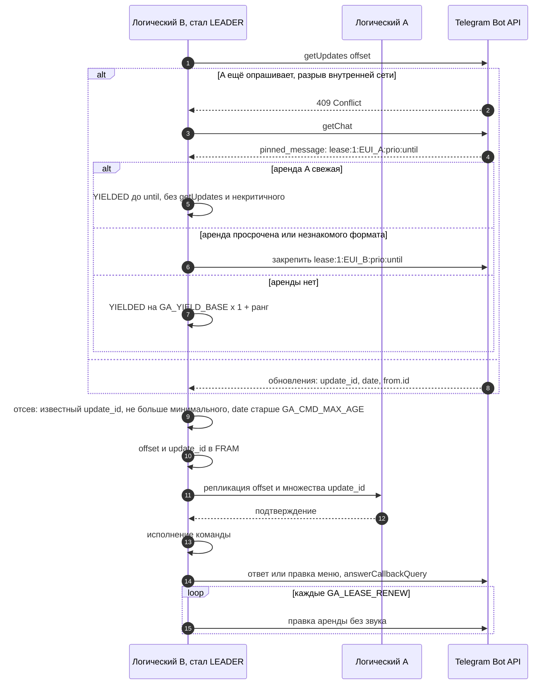

---

<a id="s5"></a>

## 5. Устройство ↔ Pushover

| Пункт | Содержание | Основание |
| --- | --- | --- |
| Кто отправляет | `LEADER`; страховка — `FOLLOWER` и `YIELDED` после `GA_CRIT_FOLLOWER_T` × (1 + ранг) (45 с; у `FOLLOWER` при живом лидере — 45 с) | AD-10, AD-11 |
| Что | только критичные события; некритичное в Pushover не уходит | AD-21 |
| API | Pushover Messages + Receipts API; URL и формат запроса в источниках не приведены — **не зафиксировано** (история 4.4) | Stack |
| Получатель | ключ группы Pushover (вся семья) — секрет узла, вводится при вводе или в «Доступах» | `external-channels.md`, AD-23 |
| Единица доставки | отдельная единица `(event_id, группа, Pushover)` | история 4.4, AD-21 |
| `priority` | `2` (emergency) | AD-21 |
| `retry` / `expire` | `GA_PUSHOVER_RETRY` = 60 с (не меньше 30 с) / `GA_PUSHOVER_EXPIRE` = 3 ч (не больше 3 ч); мягкие | `tunables.md`, `external-channels.md` |
| `tag` | `event_id` | AD-21 |
| Заголовок и текст | заголовок — первая строка тревоги без HTML; текст — время, зона, тренд | UX-DR21 |
| `sound` и прочие поля | **не зафиксировано** (история 4.4) | — |
| Receipt | сохраняется и реплицируется; опрашивается не чаще раза в 5 с (значение из истории 4.4, в `tunables.md` нет) | история 4.4 |
| Подтверждение человеком | receipt «подтверждено» → реплицируемое `ack{event_id, by}` → гасит повторы и напоминания во всех каналах | AD-21 |
| `ack` из Telegram | повторы Pushover отменяются по receipt | история 4.5 |
| Лишние копии | две экстренные копии одного события после смены лидера — лишняя отменяется `cancel_by_tag` | AD-10, AD-21 |
| Слитые открытия эпизода | если хоть одно слитое открытие уже доставлено — без Pushover | AD-21 |
| Ошибки и повторы | экспоненциальная пауза (Consistency Conventions); значения, таймаут HTTP, окончательный отказ — **не зафиксировано** | — |

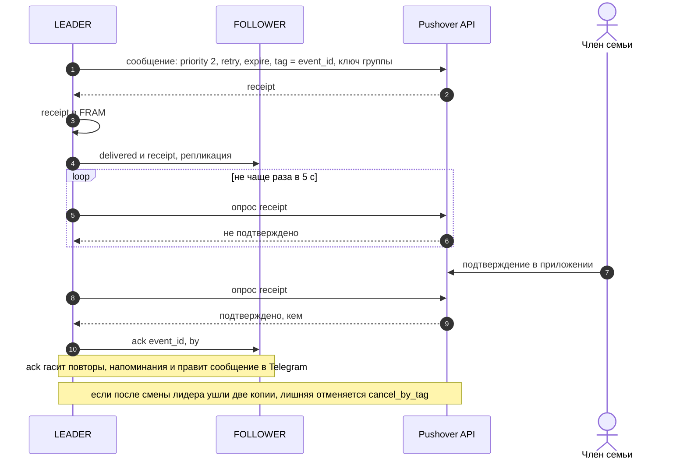

---

<a id="s6"></a>

## 6. Устройство ↔ MQTT-брокер

**Подключение** (AD-24, `external-channels.md`).

| Пункт | Содержание |
| --- | --- |
| Кто подключается | MQTT-узел публикует; все логические узлы с логином MQTT подписаны на `set` своими постоянными сессиями |
| Client ID | `ga2-<EUI-64>`, постоянный между перезагрузками и переподключениями |
| Версия | MQTT 3.1.1 / 5; команды выходов — только MQTT 5 |
| Сессия подписчика команд | `clean_start = false`, session expiry `GA_MQTT_SESSION_EXPIRY` = 10 мин (≥ `GA_CMD_MAX_AGE`); брокер держит команду, пока подписчик переподключается |
| Урезанный срок сессии или брокер без MQTT 5 | событие здоровья; на этом узле `mqtt_control` недоступен |
| Адрес, порт, TLS, префикс, «включено» | мягкий конфиг (реплицируется) |
| Логин и пароль | секрет каждого узла, вводится в локальном вебе этого узла |
| Библиотека | `espressif/mqtt` 1.0.0; исправленная копия для PUBACK — Q6, история 10.6 |
| LWT, keepalive, проверка сертификата брокера | **не зафиксировано** (истории 9.1, 10.6) |
| Роль MQTT-узла | min `leader_priority` среди узлов с `mqtt_up`, затем min EUI-64; гистерезис `GA_MQTT_UP_LOST` 30 с / `GA_MQTT_UP_RESTORED` 60 с (AD-9) |

**Темы** (AD-24).

| Тема | Направление | QoS | Retain | Содержимое |
| --- | --- | --- | --- | --- |
| `<prefix>/<node>/<channel>/state` | публикация | 1 | да | состояние канала; у выхода — подтверждённое значение |
| `<prefix>/<node>/health` | публикация | 1 | да | здоровье узла |
| `<prefix>/events` | публикация | 1 | нет | события |
| `<prefix>/<node>/<channel>/result` | публикация | 1 | нет | отказ команды с причиной, «повтор» |
| `<prefix>/<node>/<channel>/set` | подписка | 1 | retained отбрасываются | команда выходу с `mqtt_control` |

На другие темы подписок нет. Публикации — JSON с `event_id`; дубль при смене MQTT-узла распознаётся по `event_id`. Остальной состав JSON `state`, `health`, `events`, `result` и форма `<node>` / `<channel>` в теме — **не зафиксировано** (эпики 9, 10).

**Буфер зеркала.** Отдельная ограниченная область FRAM через `Storage` (регион «Буфер MQTT», 20 КБ, Structural Seed спайна), не общая с исходящей очередью; при переполнении вытесняется старейший элемент. MQTT не входит в единицы доставки и не задерживает удаление исходящего элемента; недоступный брокер не вытесняет тревог (AD-24, CAP-12).

**Команда** `<prefix>/<node>/<channel>/set`, JSON `{value, id, ts, until?}` (AD-24).

| Поле | Смысл |
| --- | --- |
| `value` | значение команды; допустимый набор (`on`, `off`, …) — **не зафиксировано** (эпик 10) |
| `id` | строка отправителя, своя у каждой команды; обязательна |
| `ts` | время отправки UTC, Unix-время в секундах, допускается дробная часть; обязательно |
| `until` | необязательно; перевод `until` в `dur_s` — **не зафиксировано** (эпик 10) |

Проверки на приёме, по порядку источников (AD-24):

| Проверка | Если не прошла |
| --- | --- |
| retained-сообщение на теме команды | отбрасывается |
| выход с флагом `mqtt_control` | команда не принимается |
| есть `id` и `ts` | отклоняется с причиной в `result` |
| `ts` не старше `GA_CMD_MAX_AGE` (10 мин) и не дальше `now` + `GA_TS_FUTURE_MAX` (5 мин) | отбрасывается |
| `cmd_id` = первые 8 Б SHA-256 от `[тема, id]` не известен в пределах `GA_CMD_MAX_AGE` | намерение не создаётся, в `result` — «повтор» |
| арбитраж на узле выхода | отказ `stale` и «защита держит» — в `result` |

Публикуется ли `result` для retained, просроченной команды и выхода без `mqtt_control`, и уходит ли PUBACK на отклонённую команду — **не зафиксировано** (история 10.6).

**Метка.** Стенка = `ts` из JSON в мс, счётчик 0 — одинаково у MQTT-узла и у страхующего ведомого; одинаковые «вкл» подряд с разными `id` — разные команды (AD-24).

**PUBACK — после FRAM** (AD-24, `durability-contracts.md`).

- MQTT-узел создаёт `output_intent` (уровень `manual`, `mqtt_key` = `cmd_id`) и пишет его во FRAM по тракту тревоги `Storage`; репликация к пирам для PUBACK не требуется.
- Ведомый пишет страховочную запись (выход, значение, срок, `mqtt_key`, метка из JSON `ts`, время своего приёма) в отдельный журнал региона `Notify`; одна запись на выход — последнего сообщения; записей ≤ `GA_MQTT_INSURE_MAX` (32).
- PUBACK шлёт сам esp-mqtt после возврата синхронного обработчика; обработчик ждёт подтверждения записи не дольше `GA_MQTT_PERSIST_WAIT` (200 мс). Нет подтверждения — PUBACK не уходит, узел переподключается, брокер повторяет сообщение в сессию; одно критичное событие здоровья на эпизод неисправности FRAM.
- Штатный esp-mqtt так не умеет, основной путь — исправленная копия компонента с решением о PUBACK из обработчика (Q6, история 10.6).

**Страховка ведомым.** Если за `GA_MQTT_INSURE_T` (10 с) после приёма не стало известно намерения с этим `mqtt_key`, ведомый создаёт его сам с той же меткой и тем же `cmd_id`; намерения веба и бота страховку не гасят. Запись закрывается намерением с этим `mqtt_key` или по `GA_CMD_MAX_AGE`. После перезагрузки страховка возобновляется после синхронизации времени и обмена событиями с пирами, без пиров — после `GA_JOIN_GRACE`. Повтор отсекает и узел выхода по `cmd_id` (AD-24).

**Результат.** Итог — в `state` (retained, подтверждённое значение после `output_state`), отказ — в `result`.

**Пример Home Assistant** (`mqtt.switch`, `external-channels.md`):

```yaml
command_template: '{"value": "{{ value }}", "id": "{{ now().timestamp() }}", "ts": {{ now().timestamp() }}}'
```

Обычные `payload_on` / `payload_off` не годятся: у них нет уникальных `id` и `ts`.

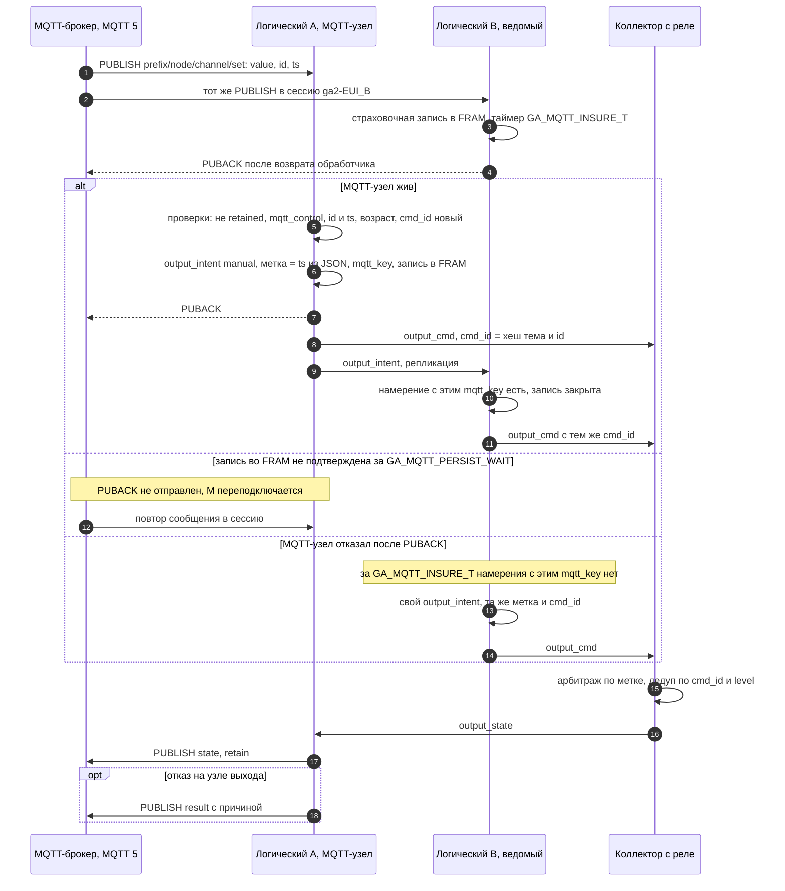

---

<a id="s7"></a>

## 7. Устройство → внешний пульс

| Пункт | Содержание | Основание |
| --- | --- | --- |
| Кто | узел, выбранный лидером по AD-9, в том числе в `YIELDED`, кроме `ISOLATED`; другие узлы не пингуют | AD-30, история 4.8 |
| Запрос | HTTPS GET на адрес пульса (сервис «мёртвой руки», совместимый с healthchecks.io) | AD-30 |
| Период | `GA_PULSE_PERIOD` = 5 мин | `tunables.md` |
| Когда не пингует | у узла есть единица доставки критичного, ожидающая дольше `GA_PULSE_STALL` (10 мин): пульс гаснет и при «живой, но немой» системе | AD-30 |
| Ответ сервиса | не используется; срок ожидания задаёт владелец на стороне сервиса, рекомендуется ≥ 3 × `GA_PULSE_PERIOD`, веб подсказывает | AD-30 |
| Ошибки | одно событие здоровья на эпизод отказа и одно на восстановление; очередь не задерживается; в единицы доставки не входит | AD-30 |
| Адрес | мягкий конфиг: реплицируется, в вебе и экспорте маскирован; импорт без адреса сохраняет действующий | AD-30 |
| Не зафиксировано | таймаут запроса, что считается отказом (код ответа), повторы внутри периода — история 4.8 | — |

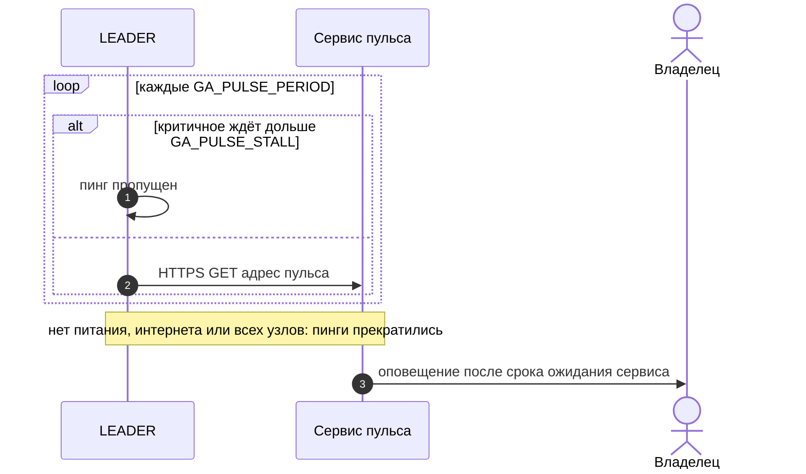

---

<a id="s8"></a>

## 8. Браузер ↔ узел (веб)

Технология веба и формат его API отложены (Deferred). Зафиксировано:

| Пункт | Содержание | Основание |
| --- | --- | --- |
| Транспорт | только HTTPS; сертификаты узлов подписывает собственный CA системы, корневой ставится на телефоны | AD-23, UX-DR59 |
| Доступ | только из локальной сети; запрос не из LAN отклоняется без страниц | SPEC Non-goals, UX-DR62 |
| Вход | логин и пароль веба — секрет узла из записи ввода | AD-23, история 5.1 |
| Блокировка по IP | после `GA_WEB_LOGIN_ATTEMPTS` (5) неверных попыток с одного IP — пауза `GA_WEB_LOGIN_LOCKOUT` (1 мин), каждая следующая серия удваивает до `GA_WEB_LOGIN_LOCKOUT_MAX` (1 ч); отслеживается `GA_WEB_LOGIN_IPS` (32) адресов, при переполнении вытесняется запись с наименьшей паузой, а первая неудача с нового IP сразу даёт первую паузу; удачный вход сбрасывает счётчик IP; текст «Слишком много попыток с этого устройства. Повторите через N мин.» | `tunables.md`, UX-DR68 |
| Сессия | истёкшая — «Сессия истекла, войдите снова»; срок сессии — **не зафиксировано** | UX-DR67 |
| Обновление сводки | `GA_WEB_REFRESH` (5–10 с) | `tunables.md` |
| Секреты | поля только на запись; по сети между узлами не передаются | AD-23, UX-DR44 |
| Экспорт и импорт | файл мягкого конфига без секретов; адрес пульса маскирован; импорт без адреса пульса сохраняет действующий; импорт не понижает номер воплощения | AD-23, AD-30, UX-DR50 |
| Опасные действия | `max_on`, смена ключа сети, «забыть узел» — после входа и с подтверждением | AD-5, AD-29 |
| Ввод и OTA | «Добавить коллектор» (Web Bluetooth), «Добавить большой узел» (пакет ключей, `GA_KEYPACK_TTL` 30 мин), загрузка образа — разделы 3.5, 3.6 | UX-DR53, UX-DR57 |

---

<a id="s9"></a>

## 9. Сводная таблица таймаутов и повторов

Значения — стартовые из `tunables.md`; «мягкая» — переопределяется мягким конфигом.

| Константа | Старт | Линия | Что ограничивает |
| --- | --- | --- | --- |
| `GA_ZB_FRAME_MAX_BYTES` | 80 Б | Л1–Л4 | один Zigbee-кадр |
| `GA_PROTO_MAC_BYTES` / `GA_NET_KEY_BYTES` | 8 Б / 32 Б | все межузловые | подпись в кадре / ключ сети |
| `GA_SEQ_WINDOW` | 512 | все надёжные потоки | окно антиповтора |
| `GA_DEDUP_BOOTS` | 4 | все надёжные потоки | хранимых окон загрузок узла |
| `GA_TS_FUTURE_MAX` | 5 мин | Л1–Л3, MQTT | допуск `ts` в будущее |
| `GA_ACK_ALL_TIMEOUT` / `GA_DEAF_MIN_RETRIES` | 5 мин / 10 повторов | Л1 (и Л3 для событий узла) | выпуск некритичного; порог «глухого» |
| пауза повтора события / команды | не зафиксировано (история 2.4) | Л1–Л3 | экспоненциальная пауза |
| `GA_COLLECTOR_NVS_BUDGET` | 2000 записей/сут | Л1 | износ NVS буфера коллектора |
| `GA_COLLECTOR_CRIT_PER_CHANNEL` / `GA_COLLECTOR_CRIT_RESERVE` | 4 / 32 события | Л1 | слияние критичных фронтов |
| `GA_COLLECTOR_CRIT_MERGE_PERSIST` | 60 с | Л1 | запись сводной записи сверх бюджета |
| `GA_HB_LOGIC` / `GA_HB_COLLECTOR` | 10 с / 30 с (по Zigbee растёт с числом узлов) | Л1–Л4 | базовый период heartbeat |
| `GA_ZB_BCAST_RATE` / `GA_ZB_BCAST_HB_SHARE` | 1/с / 50 % | Л1–Л4 | широковещание Zigbee в сети |
| `GA_ZB_UCAST_RATE` | 10/с | Л1–Л4 | одноадресные кадры Zigbee в сети |
| `GA_STALE_MISSED_HB` | 3 периода | Л1–Л4 | `stale` узла или канала |
| `GA_KID_ANNOUNCE` | 10 мин | Л3 | повтор объявления `kid` логическим узлам |
| `GA_KID_TRANSITION` | 7 сут | все | переходный период смены ключа (`T_end`) |
| `GA_UPLINK_LOST` / `GA_UPLINK_RESTORED` | 60 с / 120 с | выбор `LEADER` | гистерезис uplink |
| `GA_LEADER_RETURN` | 15 мин | выбор `LEADER` | возврат лидерства приоритетному |
| `GA_JOIN_GRACE` | 30 с | Л4, Л7 | до лидерства, `getUpdates`, `offset = −1`, страховки MQTT без пиров |
| `GA_SYNC_PERIOD` / `GA_SYNC_MAX_EVENTS` | не зафиксировано (история 3.5) | Л3 | обмен недостающими событиями |
| `GA_BULK_ZB_RATE` | не зафиксировано (история 3.2) | Л2, Л3, OTA коллекторов | `bulk` по Zigbee |
| `GA_TOMBSTONE_TTL` | 30 сут | Л3 | надгробия конфига |
| `GA_OUTPUT_LINK_LOST_HB` | 9 периодов (90 с при базовом) | Л2 | безопасное состояние `manual`/`auto` |
| `GA_OUTPUT_FEEDBACK_TIMEOUT` | 500 мс (кран: `valve_travel` + 500 мс) | на узле выхода | подтверждение второй парой контактов |
| `GA_OUTPUT_MAX_ON_DEFAULT` / `GA_OUTPUT_MAX_ON_MAX` | 1 ч (мягкая) / 12 ч | Л2 | `max_on`; верхняя граница `dur_s` (43200) |
| `GA_BUZZER_MAX` | 5 мин | Л2 | импульс зуммера, `dur_s` у `pulse` |
| `GA_VALVE_TRAVEL_DEFAULT` / `GA_VALVE_TRAVEL_MAX` | 30 с (мягкая) / 120 с | на узле выхода | ход крана |
| `GA_VALVE_DEADTIME` | 500 мс | на узле выхода | пауза перед сменой направления |
| `GA_OUTPUT_BOOT_LOOP` / `GA_OUTPUT_BOOT_STABLE` | 3 / 10 мин | Л2 | зацикливание и его сброс |
| `GA_OUTPUT_NVS_RESERVE` / `GA_OUTPUT_HOLD_WRITES_DAY` | 8 / 200 в сутки | на узле выхода | слоты `protect`, записи `hold` и цели хода |
| `GA_LOCAL_RULES_MAX` | 16 | Л2 | правил в `local_rules` |
| `GA_FRAM_INBOX_OWN_RESERVE` | 4 КБ | Л3 | резерв собственных записей при полном журнале |
| `GA_CMD_MAX_AGE` | 10 мин | Л7, Л9, правила | возраст команды Telegram и MQTT, опоздавшая причина |
| `GA_CRIT_FOLLOWER_T` | 45 с × (1 + ранг) | Л7, Л8 | страховка критичного |
| `GA_LEASE_RENEW` / `GA_LEASE_TTL` | 5 мин / 15 мин | Л7 | продление и срок аренды |
| `GA_YIELD_BASE` | 30 с × (1 + ранг) | Л7 | `YIELDED` без аренды |
| `GA_TG_EXECUTED_IDS` | 64 | Л7, Л3 | выполненных `update_id` |
| `GA_TG_SEND_GAP` | 350 мс | Л7 | пауза между отправками |
| `GA_CONFIRM_TTL` | 2 мин | Л7 | подтверждение опасной команды |
| `GA_REBOOT_NOTIFY_UNEXPECTED` / `_PLANNED` | ≤ 1 за 15 мин / ≤ 1 за 6 ч | Л7 | уведомление о перезагрузке |
| `GA_SMOKE_REMIND` | 15 мин (мягкая) | Л7 | напоминание о длящемся дыме |
| `GA_DAILY_REPORT_TIME` | 09:00 местного (мягкая) | Л7 | отчёт «жив» |
| `GA_NOTIFY_IDEMP_MARGIN` | 15 мин (+ `GA_RULE_WINDOW_MAX` 1 ч) | Л7, Л8 | идемпотентность `Notify` по `event_id` |
| `GA_OUTBOX_CRIT_QUOTA` | 25 % очереди | Л7, Л8 | квота критичного |
| `GA_PUSHOVER_RETRY` / `GA_PUSHOVER_EXPIRE` | 60 с / 3 ч (мягкие) | Л8 | emergency retry / expire |
| опрос receipt | не чаще раза в 5 с (история 4.4, нет в `tunables.md`) | Л8 | опрос подтверждения |
| `GA_MQTT_UP_LOST` / `GA_MQTT_UP_RESTORED` | 30 с / 60 с | Л9 | гистерезис `mqtt_up` |
| `GA_MQTT_SESSION_EXPIRY` | 10 мин | Л9 | постоянная сессия подписчика |
| `GA_MQTT_PERSIST_WAIT` | 200 мс | Л9 | ожидание FRAM до PUBACK |
| `GA_MQTT_INSURE_T` / `GA_MQTT_INSURE_MAX` | 10 с / 32 | Л9 | страховка ведомого |
| `GA_PULSE_PERIOD` / `GA_PULSE_STALL` | 5 мин / 10 мин | Л10 | пинг / пауза при застрявшем критичном |
| `GA_WEB_LOGIN_ATTEMPTS` / `_LOCKOUT` / `_LOCKOUT_MAX` / `_IPS` | 5 / 1 мин / 1 ч / 32 | Л11 | блокировка входа по IP |
| `GA_WEB_REFRESH` | 5–10 с | Л11 | обновление сводки |
| `GA_KEYPACK_TTL` | одноразовый, 30 мин | Л5, Л11 | пакет ключей нового узла |
| `GA_PROVISION_WINDOW` | 5 мин | Л5 | окно ввода |
| `GA_TICK_JITTER` | 50 мс | все | допуск срабатывания таймаута после `next_deadline` |

---

<a id="s10"></a>

## 10. Что не зафиксировано

<a id="s10-1"></a>

### 10.1. Открытые решения

| # | Что | Где решается |
| --- | --- | --- |
| 1 | Числовые коды типов `t`, значение `PROTO_MIN_VERSION` и первой версии | история 1.2, `components/proto` |
| 2 | Раскладка `p` и тест размера: событие (фронт), сводная запись слияния, транспортный ACK, событие здоровья, отказ и `fault` выхода | истории 2.3, 2.4, эпик 10; для ACK история не названа |
| 3 | Раскладка heartbeat (ядро, `W`, части `lw`, здоровье), объявления `kid`, запроса и ответа `lw` | история 3.1 |
| 4 | Режим Zigbee-адресации событий и heartbeat коллектора (unicast каждому или широковещание); периодичность объявления `kid` коллектором | истории 1.7, 3.1 |
| 5 | Пауза повторов событий и команд (экспоненциальная, «из `ga_config.h`» — значений в `tunables.md` нет) | история 2.4 |
| 6 | UDP: порт, unicast или широковещание, обнаружение пиров, предельный размер кадра | история 3.2 |
| 7 | `GA_BULK_ZB_RATE`, длина очереди `bulk`, противодавление | история 3.2 |
| 8 | Обмен недостающими событиями: `GA_SYNC_PERIOD`, `GA_SYNC_MAX_EVENTS`, формат сводки, запроса и ответа | история 3.5 |
| 9 | Формат записи синхронизации конфига; пометка «`k` не ниже X» | истории 3.3, 3.10 |
| 10 | Сообщения репликации `offset`, множества `update_id`, receipts и элемента исходящей очереди | истории 3.7, 4.2, 4.4 |
| 11 | `ack` и `delivered`: раскладка | история 3.7 |
| 12 | Описание каналов: поток, класс, раскладка; параметры каналов коллектора: класс, раскладка | истории 3.10, 7.1 |
| 13 | Команды правил (опросить, burst-интервал): класс, раскладка | история 8.7 |
| 14 | Когда коллектор подтверждает части `local_rules` | история 10.5 |
| 15 | Период снимков состояния канала | история 7.1 |
| 16 | Как ведомый логический узел берёт время у `LEADER` без NTP; NTP-серверы | истории 2.5, 3.6 |
| 17 | Telegram: методы отправки и закрепления, параметры long polling, «без звука», обработка 429 и ошибок, что считается окончательным отказом, поведение при откреплении аренды | истории 2.5, 3.9, 4.2, 4.5 |
| 18 | `MAX_MUTE_HOURS` и лимит списка подписчиков — упомянуты в UX-DR20 и историях 4.1, 4.5, но в `tunables.md` их нет | истории 4.1, 4.5 |
| 19 | Pushover: URL, `sound`, таймауты HTTP, повторы; период опроса receipt не перенесён в `tunables.md` | история 4.4 |
| 20 | MQTT: LWT, keepalive, проверка сертификата брокера, JSON публикаций, форма `<node>` и `<channel>` в теме, набор `value`, перевод `until` → `dur_s`; `result` и PUBACK для отброшенных команд | эпики 9, 10, история 10.6 |
| 21 | Q6: штатный способ не отправить PUBACK в esp-mqtt; иначе исправленная копия | история 10.6 |
| 22 | Пульс: таймаут запроса, критерий отказа, повторы внутри периода | история 4.8 |
| 23 | Веб: технология, формат API, срок сессии | Deferred, эпик 5 |
| 24 | OTA: механизм блокировки «один узел за раз», время проверки до отката; Q4 — OTA-сервер на роутере в distributed-сети | истории 1.6, 1.7, 6.2, 6.3 |
| 25 | Стартовые значения в целом — уточняются на прототипе; таблица бюджетов эфира, FRAM и NVS при максимуме узлов | история 1.7 |

<a id="s10-2"></a>

### 10.2. Расхождения между источниками

| # | Где | Что сказано | Противоречит | Что действует здесь |
| --- | --- | --- | --- | --- |
| 1 | `durability-contracts.md`, строка «Между логическими узлами» | «событие из обмена принимается по подписи источника и `event_id`» | AD-5, AD-17: «принимается по подписи пира, вложившего его в свой конверт»; подпись источника «хранится как есть и повторно не проверяется» (по подписи источника — только Zigbee-пересылка со старым `kid`) | спайн |
| 2 | `external-channels.md`, раздел «Bluetooth — только ввод узла» | таблица с колонкой «Логический (S3)» под заголовком Bluetooth | AD-17 и тот же файл ниже: S3 вводится через свою WiFi-точку (SoftAP), BLE — только коллектор | спайн: S3 — USB или SoftAP |
| 3 | `epics.md`, история 5.1 | «веб работает только по HTTPS с самоподписанным сертификатом узла» | AD-23: «сертификаты узлов подписывает собственный CA системы» (та же история ниже говорит о CA) | спайн |
| 4 | `epics.md`, история 6.4 и UX-DR53 | у коллектора «ключи сети передаются автоматически» | AD-5, AD-23: коллектор не знает ключа сети HMAC, получает только свои K_c (ключ Zigbee-сети — да) | спайн: ключ Zigbee-сети и K_c |
| 5 | `epics.md`, история 4.4 | receipt «опрашивается не чаще раза в 5 с» | AD-25: все интервалы — в `ga_config.h`, стартовые значения — в `tunables.md`; там этого значения нет | значение приведено со ссылкой на историю |
| 6 | `epics.md`, истории 4.1, 4.5; UX-DR20 | лимит подписчиков «из `ga_config.h`», `MAX_MUTE_HOURS` | в `tunables.md` таких констант нет (AD-25) | не зафиксировано |
| 7 | `external-channels.md`, «Внешний пульс» | «узел, выбранный лидером (и в `YIELDED`)» | AD-30 добавляет «кроме `ISOLATED`» | спайн (без uplink пинг и невозможен) |
| 8 | `garageAlarms2-протоколы.md` §13.2 (большой справочник) | у всех отброшенных MQTT-команд «причина — в `result`» | AD-24 называет `result` только для команды без `id`/`ts`, «повтора» и отказа арбитража; для retained и просроченной сказано «отбрасываются» | AD-24; остальное — не зафиксировано |
| 9 | AD-18 и UX-DR47 | логические узлы обновляются «по UDP (образ загружают через веб)» | UX-DR47: «Обновления» принимают образ этого узла — где идёт UDP-передача (с другого узла или нет), не сказано | не зафиксировано (история 6.2) |
